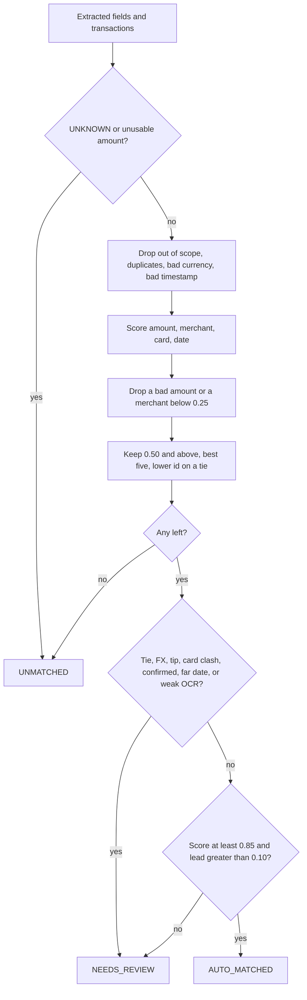
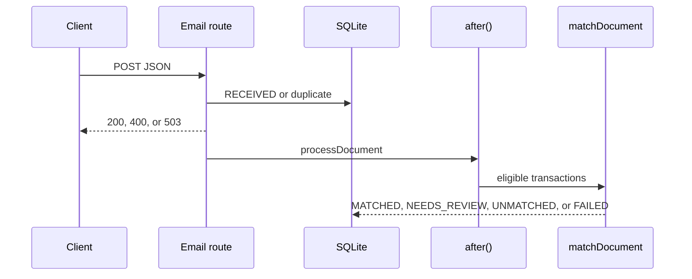
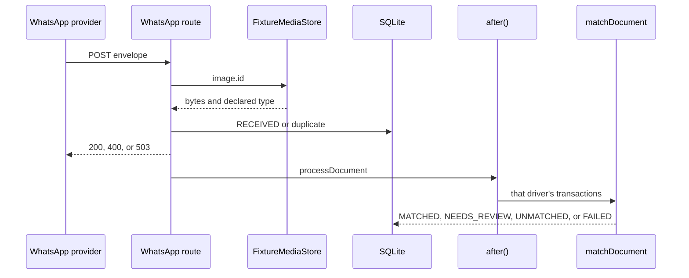
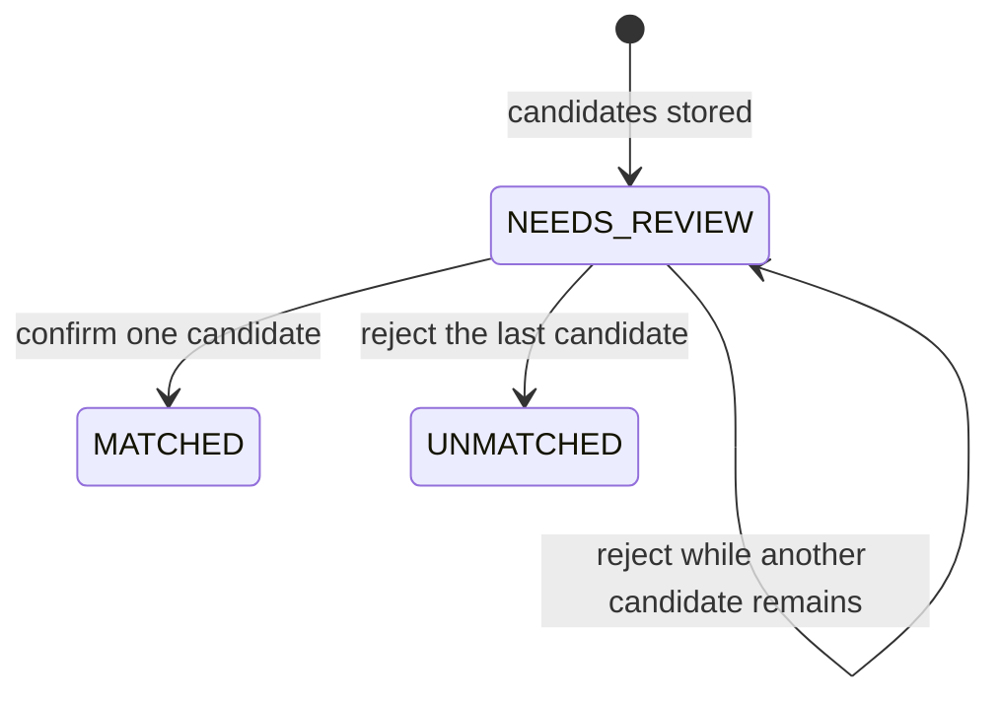
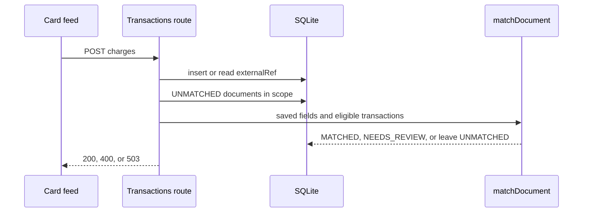

# Implementation

Drivers send receipt photos. Suppliers email tax invoices. This app attaches each document to a card transaction when the match is clear, and holds the rest for a person. The pure matcher, the mock extractor, both webhooks, confirm and reject, late-charge rematch, and the `/review` page are in the repository.

The assignment is the source of truth. Numeric thresholds are [ADR 0004](docs/decisions/0004-scoring-and-auto-match-gates.md). The matching contract is in [docs/TECHNICAL_DESIGN.md](docs/TECHNICAL_DESIGN.md).

## Prerequisites

Checked in this directory on 15 Oct 2026:

- Node.js v22.18.0 and npm 10.9.3
- Next.js 15.5.28, React 19.1.0, TypeScript 5.9.3
- Prisma 6.19.3, Zod 3.25.76, next-safe-action 8.7.3, Jest 29.7.0

## Setup

From `brijesh/`:

```bash
npm install
```

`npm install` was run when the app was created. It also runs `prisma generate`.

Copy `.env.example` to `.env` if `.env` is missing. The only value is:

```bash
DATABASE_URL="file:./dev.db"
```

Prisma's schema commands resolve that relative path from `prisma/schema.prisma`, so the file is `prisma/dev.db`. Do not point a one-off `--from-url file:./dev.db` at the same place: that form is resolved from the current directory and fails with P1003. See [docs/PHASE_1_REVIEW.md](docs/PHASE_1_REVIEW.md).

## Database

These two commands were run during phase 1. They were not run again in phase 2 or phase 3.

```bash
npx prisma migrate deploy
npx prisma db seed
```

The seed printed `{"clients":2,"emailSenders":2,"transactions":15}` and a second run printed the same counts. It upserts reference rows and does not delete documents. `billing@alfanar-fuel.com.sa` belongs to client 1.

## Commands

Run these from `brijesh/`.

| Command | What it does | This phase |
| --- | --- | --- |
| `npm test` | `jest --runInBand`. Schema, matcher, extractor, media store, both webhooks, review decisions, the review queue, and rematch. | 16 suites, 152 tests, exit 0. |
| `npx tsc --noEmit` | Typecheck. | Exit 0. |
| `npm run lint` | ESLint from the Next.js 15 setup. | Exit 0. |
| `npm run build` | `next build --turbopack`. | Exit 0. Static `/`. Dynamic `/review`, email, WhatsApp, and `/api/transactions`. |
| `npm run dev` | Next.js dev server. | Started for the email curl in phase 4. |
| `npx prisma migrate status` | Show whether `prisma/dev.db` has the migrations. | Exit 0. "Database schema is up to date!" Two migrations. |
| `npx prisma db seed` | Seed reference data. | Exit 0. Printed `{"clients":2,"emailSenders":2,"transactions":15}`. |

Do not run bare `npx jest`. The npm script forces one worker so the schema test does not share a SQLite file with another worker.

The email curl was posted in phase 4. The WhatsApp curl is in the section below.

## Layout

| Path | Role |
| --- | --- |
| `app/api/webhooks/email/route.ts` | Validates the email body, stores the file, schedules processing. |
| `app/api/webhooks/whatsapp/route.ts` | Validates the envelope, loads the media id, stores the file, schedules processing. |
| `lib/services/sender-scope.ts` | Email client lookup and E.164 phone normalization. |
| `lib/services/review-decisions.ts` | Confirm and reject inside one database transaction. |
| `lib/actions/review.ts` | `confirmMatch` and `rejectMatch`. Input is `{ matchId }`. |
| `app/api/transactions/route.ts` | Accepts a late charge and rematches usable unmatched documents. |
| `lib/services/rematch.ts` | Stores `externalRef` and reruns matching from saved fields. |
| `lib/services/document-ingestion.ts` | Hash, duplicate check, insert `RECEIVED`. |
| `lib/services/document-processing.ts` | Extract, scope, match, persist. |
| `lib/db/sqlite-url.ts` | Resolves `file:./dev.db` to `prisma/dev.db`. |
| `app/page.tsx` | Empty home page. No queue. |
| `lib/extraction/mock-extractor.ts` | Hash of the file bytes to a fixture extraction. |
| `lib/extraction/to-fields.ts` | Maps that extraction onto `matchDocument`. |
| `lib/media/fixture-media-store.ts` | WhatsApp media id to a file under `fixtures/`. |
| `lib/matching/config.ts` | Every weight and threshold. |
| `lib/matching/signals.ts` | Amount, merchant, card, and date scores. |
| `lib/matching/normalize.ts`, `similarity.ts` | Merchant text. |
| `lib/services/transaction-matcher.ts` | `matchDocument`. Pure. |
| `fixtures/documents/` | Synthetic text. Not scanned images. |
| `prisma/schema.prisma`, `prisma/seed.ts` | Tables and the 15 charges. |
| `__tests__/matching/` | Matcher unit tests. No database. |
| `__tests__/ingestion/` | Extractor tests, the email webhook test, and the WhatsApp webhook test. Each webhook uses its own file under `.test-db/`. |
| `__tests__/schema/` | Migration and seed tests. |

Planned and not present: `/review`.

## Matching

`matchDocument(doc, transactions, scope)` returns `AUTO_MATCHED`, `NEEDS_REVIEW`, or `UNMATCHED`, plus ranked candidates. It does not read Prisma, the filesystem, the clock, or `Math.random`. The caller passes only the transactions it already loaded, and a scope:

- Email: `{ kind: 'EMAIL', clientId }` keeps that client's rows.
- WhatsApp: `{ kind: 'WHATSAPP', driverPhone }` keeps that exact phone. The caller converts the sample `966551234567` to `+966551234567` first.

Scope is a filter, not a fifth weight. A cross-client twin never receives a partial score.



### Numbers

All of these are `defaultMatchConfig` in `lib/matching/config.ts`.

| Knob | Value |
| --- | --- |
| Weights | amount 0.40, merchant 0.25, card 0.20, date 0.15 |
| Missing signal | Omit it. Multiply the weighted mean by `min(1, availableWeight / 0.75)`. |
| Confidence | Rounded to 4 decimal places before it is compared. |
| Auto-match | At least 0.85, and the lead over the next candidate greater than 0.10. |
| Review floor | 0.50. At most 5 candidates. |
| Extraction confidence | At least 0.60, or the result stays in review. |
| Tip | Charge above the receipt by at most 20% scores 0.5, flag `TIP`, and cannot auto-match. |
| Rounding | The larger of 5 minor units and 1% of the compared amount scores 0.9. Checked before the tip. For SAR, 5 minor units are 5 halalas. |
| Merchant | Below 0.25 the candidate is dropped, even when the card matches. |
| Date | Riyadh calendar day, UTC+3, no daylight saving. Same day is 1. A gap of 1 to 7 days is `1 - dayGap / 8`. Day 8 and after is 0, which blocks auto-match. A missing date is left out and does not block. |

A charge below the receipt, outside the rounding band, is a different purchase and is dropped. A 15% gap is not detected as pre-VAT. It falls inside the 20% band, so it is flagged as a tip and cannot auto-match.

### Currencies

Amounts stay integers in that currency's minor units. `100.00 USD` is `10000` cents. `1000 JPY` is `1000`. `1.500 KWD` is `1500` fils. A blank receipt currency is SAR. An unknown code is dropped, and the charge API rejects it.

The same currency is scored as before and can auto-match. A USD receipt and a USD charge never pass through a rate.

A different currency is converted only for `scoreAmount`, and only when both sides have an official US dollar peg in `lib/money/fx.ts`. The peg used here is 1 USD = 3.75 SAR, so `10000` cents becomes `37500` halalas. The stored receipt and the stored charge keep their original amounts. The candidate is flagged `FX` and cannot auto-match, because a bank spread can make a true pair look slightly off. EUR, GBP, and JPY have no peg in this table, so a euro receipt does not rank against a riyal charge. [ADR 0008](docs/decisions/0008-currency-minor-units.md).

### Why these numbers

Amount is the fact that is usually exact, so it has the largest weight. The card is strong when the receipt shows it, and omitted when it does not, so a missing card is not a penalty. The date catches a stale receipt without throwing away a receipt whose date failed OCR. Coverage stops a single signal from looking like a full match: amount alone stays under 0.85.

The two reference projects were read and not copied.

- One reference leaves a date score of 0 inside the average and can still auto-match at 0.85. A printed date that disagrees with the charge should not auto-attach, so a present date of 0 forces review here.
- That same reference can keep a weak merchant when the card matches. This matcher drops the merchant below 0.25 anyway.
- The other reference refuses auto-match when the date is missing, and it can auto-match a 15% pre-VAT gap. A missing date is allowed to auto-match here when the other signals are exact. Pre-VAT is not its own rule.

There is no labelled production set. Later, confirm and reject rates would be the way to move 0.85 or 0.10.

### Worked edges

| Situation | Result |
| --- | --- |
| Exact amount, merchant, day, and card | `AUTO_MATCHED`, confidence 1 |
| Exact amount and merchant, no card, same day | `AUTO_MATCHED` |
| Exact amount, merchant, and card, date missing | `AUTO_MATCHED` |
| Albaik, two charges of 48.00 SAR on 12 Jun 2025 | `NEEDS_REVIEW`, both ids, lower id first |
| Receipt 57.50 SAR, charge 63.25 SAR, same merchant and day | `NEEDS_REVIEW`, amount 0.5, flag `TIP` |
| Same photo's charge already confirmed | `NEEDS_REVIEW` |
| Only the other client's twin is in scope | `UNMATCHED` |
| `UNKNOWN` or a null amount | `UNMATCHED`, no throw |
| Date 7 days away, everything else exact | `AUTO_MATCHED`, date score 0.125 |
| Date 8 or more days away, everything else exact | `NEEDS_REVIEW` |
| 21:00 UTC on 14 Jun 2025 | Next calendar day in Riyadh |
| Receipt and charge both 100.00 USD | `AUTO_MATCHED`. No conversion |
| Receipt 100.00 USD, charge 375.00 SAR | `NEEDS_REVIEW`, amount 1, flag `FX` |
| Receipt in EUR, charge in SAR | `UNMATCHED`. No peg |

### Multi-invoice sketch

Not implemented. BON-003 stays a sketch.

One emailed statement that lists several charges would still create one `Document`. The matcher would return several candidates instead of one winner, and the result would stay `NEEDS_REVIEW`. A person would confirm each charge. The partial unique index on `DocumentMatch(documentId)` would have to be dropped before one document could be confirmed against more than one transaction. The index on `transactionId` would stay, so each charge would still have one confirmed document. Automatic split of a statement is not part of this exercise.

## Mock extractor

`MockExtractor.extract(file, mimeType)` implements the assignment interface. It hashes the buffer with SHA-256 and returns the fixture for that hash. The same bytes always return the same fields. Unknown bytes return `UNKNOWN`, a null amount, and confidence 0. The `unreadable-scan` fixture throws `ExtractionError` with code `UNREADABLE`. A value that fails the Zod schema throws `INVALID_OUTPUT`.

The MIME type is not the lookup key. `fixtures/media-map.json` stores the type a webhook would declare. `media_4471`, the sample WhatsApp id, maps to `fixtures/documents/exact-alfanar.txt` and is declared `image/jpeg`. The `.txt` extension is not evidence of the contents. Those files are synthetic placeholders.

`toExtractedFields` drops the VAT number, the invoice number, and `rawText` before matching. A VAT number that is not 15 digits is kept on the extraction and ignored by the matcher.

A second file, `alfanar-second-photo`, extracts to the same fields as `exact-alfanar` and has a different hash. Identical extraction is not deduplication. Deduplication of the same bytes is phase 4.

`TesseractExtractor` has the same `extract` method. `createDocumentExtractor` returns it only when `EXTRACTOR=tesseract`. The mock stays the default, so `npm test` does not download a model and does not call the network.

Set `EXTRACTOR=tesseract` in the environment and restart the server to read a real photo. JPEG, PNG, WEBP, and BMP go through Apple Vision on macOS. The first call compiles a small reader into the OS temp directory. A digital PDF is read from its text layer and stored at confidence 0.59, under the auto-match gate. A scanned PDF, with no text layer, becomes `FAILED` / `UNREADABLE`. Send a photo of that page instead. The sample webhook files are synthetic text. Leave `EXTRACTOR` unset when you post them. Details are in [ADR 0009](docs/decisions/0009-tesseract-extractor.md).

Email and WhatsApp tests call `POST` on the route. Jest replaces `after()` so the real `processDocument` finishes before the assertion. The dev-server curls below do not replace `after()`.

## Email webhook

`POST /api/webhooks/email` accepts the assignment body. There is no signature. `from` is matched, lower-cased, to `ClientEmailSender`. The attachment is the base64 file itself. This route does not use `FixtureMediaStore`.



A successful body is `{ "documents": [{ "documentId": 1, "result": "created" }] }`. A bad body is 400 with `error` and `issues`. An insert that is not a unique conflict is 503 `{ "error": "STORE_FAILED" }`. The match outcome is in the database, not in the HTTP body.

The sample file is `fixtures/webhooks/email-exact.json`. It wraps the synthetic `exact-alfanar` bytes. Against the seed, client 1, processing stores one document, status `MATCHED`, and one `AUTO_CONFIRMED` match on transaction 1.

```bash
curl -s -X POST http://localhost:3000/api/webhooks/email \
  -H 'content-type: application/json' \
  --data-binary @fixtures/webhooks/email-exact.json
```

That command was run on 15 Oct 2026 against `npm run dev` at `http://localhost:3000`. The response was `{"documents":[{"documentId":1,"result":"created"}]}`. The row in `prisma/dev.db` is document 1, status `MATCHED`, reason `AUTO`, scope `EMAIL:billing@alfanar-fuel.com.sa`, total 12500, merchant `Alfanar Fuel Station`, and one `AUTO_CONFIRMED` match on transaction 1 with confidence 1 and `decidedBy` `system`. A second post returned `duplicate` and left the document count at 1. `PRAGMA database_list` for the app client was `prisma/dev.db`. There is no `brijesh/dev.db`.

## WhatsApp webhook

`POST /api/webhooks/whatsapp` accepts the assignment envelope. There is no signature. `from` is normalized to E.164. `966551234567`, `+966551234567`, `00966551234567`, and `0551234567` all become `+966551234567`. The media id is looked up in `FixtureMediaStore`. The payload `sha256` is ignored. The stored hash is the SHA-256 of the fixture bytes.



The response shape matches email. A non-image message, an invalid phone, an unknown media id, a non-image fixture, or a file over 10 MiB returns 200 and an empty `documents` array. A phone that is valid and matches no driver is stored as `UNMATCHED` / `UNKNOWN_SENDER`.

The sample file is `fixtures/webhooks/whatsapp-exact.json`. `media_4471` is the exact Alfanar fixture, declared `image/jpeg`. The bytes are synthetic text. Against the seed, the driver `+966551234567` matches transaction 1.

```bash
curl -s -X POST http://localhost:3000/api/webhooks/whatsapp \
  -H 'content-type: application/json' \
  --data-binary @fixtures/webhooks/whatsapp-exact.json
```

That command was run on 15 Oct 2026 against `npm run dev`. The response was `{"documents":[{"documentId":2,"result":"created"}]}`. A second post returned `duplicate` and left the document count at 2. Document 2 is `WHATSAPP`, scope `WHATSAPP:+966551234567`, merchant `Alfanar Fuel Station`, total 12500, status `NEEDS_REVIEW`, reason `ALREADY_CONFIRMED`, with one `CANDIDATE` on transaction 1. Transaction 1 was already `AUTO_CONFIRMED` by the phase 4 email document, so this photo could not take it. On a database where transaction 1 is still open, the same request is `MATCHED` with one `AUTO_CONFIRMED` row. That is what `__tests__/ingestion/whatsapp-webhook.test.ts` asserts.

## Confirm and reject

`confirmMatch({ matchId })` and `rejectMatch({ matchId })` are server actions. The Jest suite calls `confirmMatchDecision` and `rejectMatchDecision` directly. It does not import the `'use server'` module. There is no signed-in reviewer, so `decidedBy` is the constant `reviewer`.

A confirm is allowed only for a `CANDIDATE` on a `NEEDS_REVIEW` document whose transaction belongs to that email client or that WhatsApp driver. It sets that row to `CONFIRMED`, the other candidates to `REJECTED`, and the document to `MATCHED`. A reject sets that candidate to `REJECTED`. The document becomes `UNMATCHED` only when no candidate remains. A rejection never turns a row into a confirmation, and it does not undo `CONFIRMED` or `AUTO_CONFIRMED`.

Two confirms of one transaction cannot both commit. The partial unique indexes reject the second write, the transaction rolls back, and the caller receives `CONFLICT`. Repeating the same confirm returns `ALREADY_CONFIRMED`. Repeating the same reject returns `ALREADY_REJECTED`. A processing result that arrives after the document is already `MATCHED` does not replace the reviewer row.



## Late charges

`POST /api/transactions` accepts `{ transactions: [...] }`. Each charge needs `externalRef`, `clientId`, a 4-digit `cardLast4`, `merchantName`, a positive integer `amount` in halalas, and `transactionAt`. `driverPhone` is optional. The same `externalRef` returns the existing row and does not change it.

After the charge is stored, usable `UNMATCHED` documents for that email client or that driver phone are matched again from the fields already on the document. `UNKNOWN` and a null amount stay unmatched. `MATCHED`, `NEEDS_REVIEW`, `FAILED`, and `RECEIVED` are not reopened. A transaction the reviewer already rejected is left out of the candidate list. Two early receipts for one new charge leave one `AUTO_CONFIRMED` row. The other document goes to review.



## Review queue

`/review` loads documents whose status is `NEEDS_REVIEW`, `MATCHED`, or `UNMATCHED`, with their match rows and those rows' transactions, in one query, then splits them into three lists. Needs review is the only list with confirm and reject. Attached shows a receipt the matcher confirmed on its own. Unmatched is read-only, including a leftover `CANDIDATE` row, because confirm requires `NEEDS_REVIEW`. Amounts are integer minor units shown with the currency code. Dates use the Riyadh calendar. Missing extraction is the text "Not extracted". An image MIME type is drawn from `/api/documents/[id]/file`. A text fixture says no preview is shown.

Confirm and reject submit `{ matchId }` to `confirmMatch` and `rejectMatch`. The browser does not decide whether a row may change. A candidate that is not `CANDIDATE`, and a confirm button for a transaction that already has a confirmation, are not offered. While a request is in flight, the buttons are disabled. Success is shown only when the action returns `CONFIRMED` or `REJECTED`. `CONFLICT`, `ALREADY_CONFIRMED`, `ALREADY_REJECTED`, and `NOT_FOUND` stay on the page and tell the reviewer to refresh. An unexpected failure says the decision was not saved. After a returned decision the route is revalidated and the page refreshes from the database.

The browser pass is recorded in [README.md](README.md). It used an isolated database. `prisma/dev.db` still holds the email document and the WhatsApp document from phases 4 and 5.

## Upload desk

`/upload` accepts a PNG, JPEG, WEBP, or PDF, or one of the two demo photos. `POST /api/uploads` and `POST /api/uploads/example` validate the file, then call the email ingestion path with sender `billing@alfanar-fuel.com.sa` (ASM-010). Processing still runs in `after()`. The page polls `GET /api/documents/[id]/status` until the document leaves `RECEIVED` or `EXTRACTED`, then shows the text Tesseract read, the amount in the receipt currency, and the charge it was scored against. A same-currency auto-match and a pegged cross-currency review use that one screen. The desk does not score and does not confirm.

## Adding a feature

1. Read the requirement ID in `docs/requirements/REQUIREMENTS.md` and the phase in `docs/IMPLEMENTATION_PLAN.md`.
2. Keep scoring in `lib/matching/` and `matchDocument`. A new weight goes in `config.ts`, the tests, this file, and ADR 0004 together.
3. Put matcher tests in `__tests__/matching/` and extractor tests in `__tests__/ingestion/`. They take plain objects or fixture bytes. They do not open SQLite.
4. Run `npm test`, `npx tsc --noEmit`, and `npm run lint`.
5. Move the ID in `docs/REQUIREMENT_TRACEABILITY.md` to `verified` only after that command has been run.

## What works today

- `npm test` covers the schema, the seed, `matchDocument`, the mock extractor, the media store, both webhook routes, confirm/reject, the review queue, and late-charge rematch on isolated databases.
- `npm run dev` serves the home page, `/review`, and the webhook routes.
- The seed data is in `prisma/dev.db`. The email route reads and writes that file when the server is running.

## Limitations

- The default extractor is a fixture lookup. `EXTRACTOR=tesseract` reads photos with Apple Vision on macOS, and digital PDFs by their text layer. It does not read a scanned PDF. A confirmed charge's competing candidates on other documents are not withdrawn. The review page can reject that leftover candidate. It does not withdraw it automatically.
- A WhatsApp message with no resolvable image bytes is acknowledged and not stored. A crash after the 200 still leaves a stored row `RECEIVED` until that message is posted again.
- The email response is sent before matching finishes. A crash after the response leaves the row `RECEIVED` until the same message is posted again.
- The fixture files are synthetic text. A real image is not in the repository.
- Relative `file:./dev.db` is safe for the CLI and for today's unbundled client. Resolve it to an absolute path before the first route imports `lib/prisma.ts`.
- `npx jest` without `--runInBand` can collide on the schema test's single database file.
- Merchant similarity is Latin text only. Arabic names are not folded.
- A 15% VAT gap is flagged as a tip, not as VAT.
- Cross-currency scoring uses official dollar pegs only. EUR, GBP, and JPY are stored and can match themselves. They are not converted into riyals.
- `brijesh/` is not a git repository. Initialize git only here, not in the parent folder.
