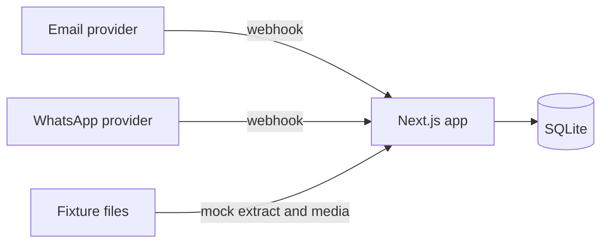
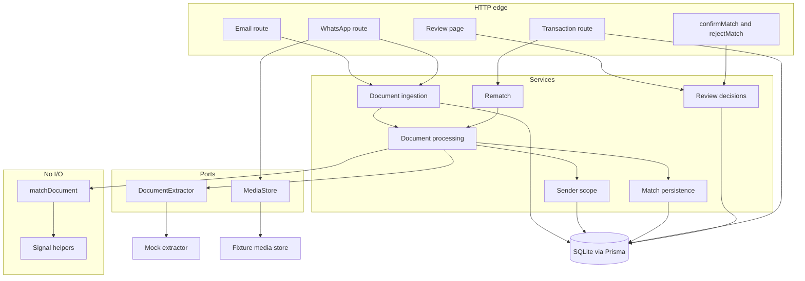
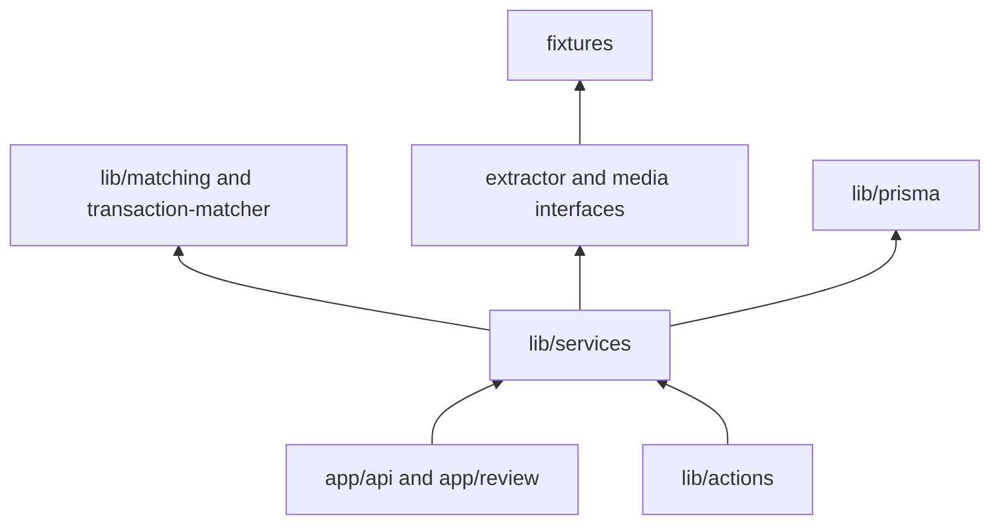
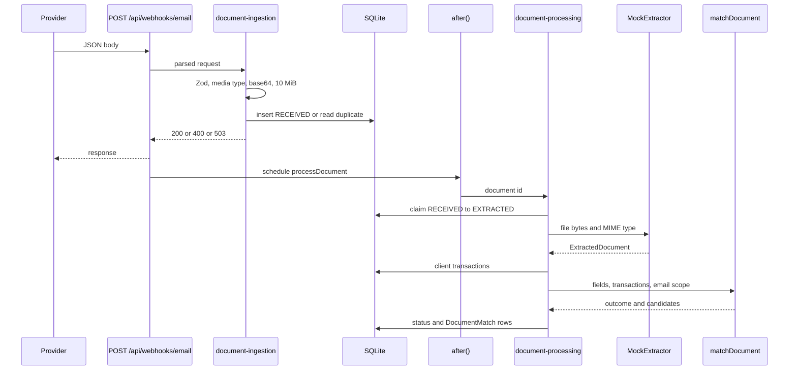
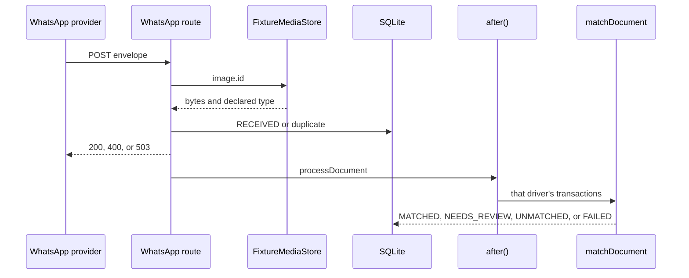

# Architecture

Phase 8 has both webhooks, confirm and reject, rematch when a charge arrives, and `/review`. Accepted decisions are linked.

The charter is [PROJECT.md](PROJECT.md). Module-level detail is [TECHNICAL_DESIGN.md](TECHNICAL_DESIGN.md).

## Overview

One Next.js process. HTTP handlers validate and store. A pure matcher never sees the database. Persistence and the review service enforce "one confirmed document per transaction" in SQLite, not only in the page.

Processing runs after the webhook response so a slow extract does not force the provider to time out (FR-006). Both webhook routes use Next.js `after()` ([ADR 0006](decisions/0006-processing-model.md)).

## Context

The default extractor is still the fixture lookup. `EXTRACTOR=tesseract` reads photos with Apple Vision and a digital PDF by its text layer ([ADR 0009](decisions/0009-tesseract-extractor.md)). There is no Meta Graph call and no SMTP server. HMAC remains later ([ADR 0002](decisions/0002-defer-hmac-and-live-extractor.md)).

## Components

All of the following are planned.

| Module | Responsibility | Depends on | Must not depend on |
| --- | --- | --- | --- |
| Route handlers | Read the body, validate, map HTTP status, schedule work | Ingestion service | Scoring arithmetic |
| Ingestion | Normalize the sender, hash bytes, insert `RECEIVED`, recognize duplicates | Prisma, media store | Matcher weights |
| Processing | Extract, claim the row, load scope, call the matcher, save | Extractor, scope, matcher, persistence | React |
| Sender scope | Turn a phone or email into the allowed transactions | Prisma | String similarity |
| Matcher | Rank candidates and choose auto, review, or unmatched | Signal helpers | Prisma, `fs`, network, clock |
| Persistence | One database transaction for status plus match rows | Prisma | HTTP |
| Review decisions | Confirm and reject with guarded updates | Prisma | Matcher formula |
| Mock extractor | Hash to fixture | Fixture files | Transactions |
| Fixture media store | Media id to a file under `fixtures/` | The map file | The network |

`/review` lists `NEEDS_REVIEW` documents with confirm and reject (BON-001, FR-028, FR-029) and lists `UNMATCHED` documents without those actions. Rematch runs when `POST /api/transactions` stores a charge (BON-002). The page does not score or change a row on its own.

`/upload` is an operator shortcut (ASM-010). It stores the file as email from the seeded Alfanar mailbox and uses the same ingestion path. It is not a third source.

## Dependency direction

`lib/matching` and `lib/services/transaction-matcher.ts` do not import `lib/services` or `lib/prisma`. ESLint is planned to enforce that (see [TEST_STRATEGY.md](TEST_STRATEGY.md)). The rule is proposed with the toolchain, not present.

## Email flow

A non-image message, an invalid phone, an unknown media id, a non-image fixture type, or a file over 10 MiB is 200 and is not stored. The schema requires document bytes, and the content hash is the SHA-256 of those bytes, so a missing file is not saved as `FAILED`.

## Data flow

1. The email body becomes a validated object or a 400.
2. Bytes are hashed with SHA-256. A duplicate `messageId#index` or the same hash in the same `EMAIL:` scope returns the existing document (FR-004, FR-005, ADR 0003).
3. A new row is `RECEIVED`. The response is 200.
4. `after()` runs extraction. A throw sets `FAILED`. `UNKNOWN` or an unusable amount sets `UNMATCHED` (FR-007, FR-027).
5. An unknown sender is stored as `UNMATCHED` / `UNKNOWN_SENDER`. The matcher is not called (ADR 0007).
6. The client query loads that client's transactions. `matchDocument` also drops other clients (FR-009).
7. Persistence writes the outcome in one database transaction. An auto-confirm that loses the partial unique index is saved as `NEEDS_REVIEW`.

## Integration boundaries

| Boundary | Contract | Failure |
| --- | --- | --- |
| Email JSON | Zod schema matching the sample payload (FR-001, FR-003) | 400, no row |
| WhatsApp JSON | Zod schema matching the sample envelope (FR-002) | 400, no row |
| `MediaStore` | `get(mediaId) -> { bytes, mimeType }` | Unknown id does not throw out of the route (FR-008) |
| `DocumentExtractor` | The assignment interface (FR-010) | Throw becomes a terminal document state |
| `matchDocument` | Pure. Inputs are extracted fields plus candidate transactions (FR-015) | Bad candidates are skipped. No throw on garbage fields |
| Prisma | The only writer of `Document` and `DocumentMatch` | Insert failure returns 503 `STORE_FAILED` |
| Server actions | `matchId` number (CON-012, FR-028) | Validation error from the action client. No partial confirm |

HMAC, if added later, sits in the route before Zod, over the raw bytes. It is not in this diagram as a current component.

## Error handling

| Class | Who handles it | Caller sees |
| --- | --- | --- |
| Bad HTTP body | Route | 400 and a field-level message (FR-003) |
| Duplicate delivery | Ingestion | 2xx and the existing id (FR-004, FR-005) |
| Unknown media id or non-image message | Ingestion | 200, no row. A media-store error that is not "unknown id" is 503 |
| Extractor throw, bad extraction | Processing | 2xx already sent. Document `FAILED` or `UNMATCHED` |
| Unknown sender or no plausible candidate | Processing | Document `UNMATCHED` |
| Two confirms of one transaction | Database partial index | One commit. The other rolls back (FR-031) |
| Process dies after the response | The row stays `RECEIVED` | A redelivery of that message schedules processing again. A claim older than 5 minutes can be taken again (ADR 0006). There is no cron. |

`processDocument` catches extractor failures and does not reject into the route (NFR-005). A database error during processing is logged and leaves the row `EXTRACTED` rather than `UNMATCHED`.

## Security

Accepted limits: no authentication (ASM-006). No HMAC until after the review page.

Practices in the email route:

- Logs record the message id, document id, and created-or-duplicate result. They do not record bytes, base64, or `rawText`.
- The stored hash is SHA-256 of the bytes. The WhatsApp `sha256` field is not a deduplication key.
- WhatsApp logs record document ids, created-or-duplicate, and skip reasons. They do not record the phone number or the file bytes.
- A decoded email attachment is capped at 10 MiB. That cap is local, not in the assignment.
- Allowed email media types are `application/pdf`, `image/jpeg`, `image/png`, and `image/webp`. The check uses the declared `contentType`, not the filename.
- Validation errors name the field and do not echo the submitted attachment.
- There is no signature check (ADR 0002).

## Performance

The seed is about 15 transactions (FR-014). Loading every in-scope transaction is enough. A date window on the candidate query is a reasonable addition when the matcher is wired, and it is not a separate service. There is no queue, cache, or worker process in the plan.

SQLite has one writer. The planned test runner uses one worker or one connection so parallel writes do not flake. That constraint is operational, learned from both references, and not an assignment sentence.

## Runtime

Planned: `next dev` or `next start` on one machine, SQLite file from `DATABASE_URL`, fixtures read from disk. No containers. No hosted environment.

A relative `file:` URL can be resolved from a `.next` chunk directory under the bundled server. If that appears, resolve the path to an absolute file URL before constructing the client. That fix is conditional. It is not part of the design until it is observed.
