# Implementation plan

ADR 0001 through ADR 0007 are accepted. Phase 1 is implemented. Dependencies were installed in that phase. Later phases start only when that phase is requested.

The first milestone is a thin path that is real: one known email fixture becomes one `MATCHED` document. Later phases add the edges, the second channel, and the bonuses. Module boundaries from [TECHNICAL_DESIGN.md](TECHNICAL_DESIGN.md) are used from the start so later phases fill behavior instead of replacing files.

```mermaid
flowchart LR
  p1[Phase 1 skeleton and schema] --> p2[Phase 2 matcher]
  p2 --> p3[Phase 3 mock extractor]
  p3 --> p4[Phase 4 milestone: email exact match]
  p4 --> p5[Phase 5 edges idempotency WhatsApp]
  p5 --> p6[Phase 6 confirm and reject]
  p6 --> p7[Phase 7 rematch]
  p7 --> p8[Phase 8 review page]
  p8 --> p9[Phase 9 HMAC]
  p9 --> p10[Phase 10 live extractor]
```

Phases 1–6 are the graded core. Phases 7–8 are accepted bonuses (Q-005). Phases 9–10 are deferred by [ADR 0002](decisions/0002-defer-hmac-and-live-extractor.md).

If time runs short, stop after phase 6. Do not skip phase 5 to reach the page (NFR-007).

## Phase 1: Skeleton and schema

Goal: a Next.js app with an empty home page, Prisma, and the tables.

Requirements: CON-001 through CON-009, CON-011, CON-012, FR-013, FR-014.

Prerequisites: ADR 0003, ADR 0005, ADR 0006, and ADR 0007, all accepted.

Files: `package.json`, `tsconfig.json`, `app/layout.tsx`, `app/page.tsx`, `lib/prisma.ts`, `lib/utils.ts`, `lib/logger.ts`, `prisma/schema.prisma`, `prisma/migrations/`, `prisma/seed.ts`, `.gitignore`. No webhook yet.

Tasks:

- Create the app with the assignment's stack. Do not copy either reference's `package.json`.
- Turn on `strict` and `noUncheckedIndexedAccess` (NFR-001, REC-005).
- Model the assignment entities plus `Client` and `ClientEmailSender` ([ADR 0007](decisions/0007-email-sender-scope.md)). Apply the accepted integer ids and ADR 0003, ADR 0005, and ADR 0006.
- Hand-write both partial unique indexes from ADR 0005.
- Seed two clients and about 15 transactions, including an ambiguous same-day pair and a cross-client twin. Seeding again must not delete documents (REC-006).
- Map `billing@alfanar-fuel.com.sa` to client 1 (ASM-004).

Tests: migration applies; both partial unique indexes exist; seed row counts; seed is repeatable and does not delete documents.

Acceptance: `npx tsc --noEmit` and the schema test have been run, and the README setup section is updated to the commands that worked.

Risks: Prisma drift dropping hand-written SQL. A Next.js major newer than 15 if `create-next-app` is invoked without a version. Pin the majors the assignment names.

Done on 15 Oct 2026. `npx prisma migrate deploy`, `npx prisma db seed`, `npm test` (6 passed), `npx tsc --noEmit`, and `npm run lint` were run from this directory. The README setup section matches those commands.

## Phase 2: Matcher

Goal: the pure function and the six edges, with no HTTP.

Requirements: FR-015 through FR-024, FR-026, FR-027 at the function layer, FR-032, NFR-004, NFR-006.

Prerequisites: phase 1. ADR 0004 is accepted.

Files: `lib/matching/*`, `lib/services/transaction-matcher.ts`, `__tests__/matching/*`, root `IMPLEMENTATION.md` (FR-017, FR-035).

Tasks:

- Implement the accepted formula. Keep every number in `config.ts`.
- Cover the worked table, the tie, the tip, a missing date (auto-match when amount, merchant, and card are exact), a present date that scores 0 (review), the card mismatch, the other client's absence (callers pass only in-scope rows; an empty list is `UNMATCHED`), and messy merchant strings.
- Add a purity test: the matcher module does not import Prisma, `fs`, or `path`, and does not call `Date.now` or `Math.random`.
- Write `IMPLEMENTATION.md` with the weights, the gates, ASM-001 through ASM-005, and the trade-off against the two references. Add the BON-003 sketch only if that bonus stays.

Tests: unit only. No database.

Acceptance: the required edges pass. `IMPLEMENTATION.md` agrees with `config.ts`.

Risks: floating-point boundaries. The 4-decimal rule exists to make them boring. Do not assert on unrounded binary fractions.

Done on 15 Oct 2026. `npm test`, `npx tsc --noEmit`, `npm run lint`, and `npm run build` were run. The worked edges pass. Root `IMPLEMENTATION.md` matches `lib/matching/config.ts`.

## Phase 3: Mock extractor and media

Goal: fixtures the pipeline can call.

Requirements: FR-008, FR-010, FR-011, FR-012.

Prerequisites: phase 2, so fixture extractions are checked against the real matcher where that is cheap. The extractor itself does not need the matcher.

Files: `lib/extraction/*`, `lib/media/fixture-media-store.ts`, `fixtures/documents/*`, `fixtures/media-map.json`, `__tests__/ingestion/extractor.test.ts`.

Tasks:

- Implement the assignment interface verbatim.
- Key the mock by SHA-256. Unknown bytes return `UNKNOWN`, null amount, confidence 0.
- Add the six fixtures plus a throwing fixture.
- Validate extractor output with Zod before the rest of the app trusts it.
- Keep media paths inside `fixtures/`.

Tests: same bytes, same result. Unknown hash. Unknown media id. Path escape rejected.

Acceptance: FR-012's files exist and the hash test passes.

Risks: hashing a filename instead of the bytes. The test should rename nothing and should feed a buffer.

Done on 15 Oct 2026. `npm test`, `npx tsc --noEmit`, `npm run lint`, and `npm run build` were run. The hash lookup, the media map, and the extractor-to-matcher cases pass. Webhooks are still phase 4.

## Phase 4: Milestone — one email, exact match

Goal: the smallest running path. A seeded invoice fixture posted to the email webhook ends `MATCHED` with one `AUTO_CONFIRMED` row. A bad body returns 400. Posting the same body again does not add a row.

Requirements: FR-001, FR-003, FR-004, FR-005, FR-006, FR-009 for the email client, FR-018, FR-033 for this path, FR-034 for the one curl that was run.

Prerequisites: phases 1–3. ADR 0003, ADR 0006, and ADR 0007 are accepted.

Files: `app/api/webhooks/email/route.ts`, `lib/services/document-ingestion.ts`, `document-processing.ts`, `sender-scope.ts`, `match-persistence.ts`, `__tests__/ingestion/email-exact.test.ts`.

Tasks:

- Validate with Zod. Store `RECEIVED`. Respond. Process via `after()` ([ADR 0006](decisions/0006-processing-model.md)).
- Load only that client's transactions through `ClientEmailSender`. An unknown sender is stored as `UNMATCHED` ([ADR 0007](decisions/0007-email-sender-scope.md)).
- Save the match in one database transaction.
- On extractor failure, store a terminal state and still return 2xx. One test uses the throwing fixture even if the happy path does not.
- Update the README with the curl that was actually run.

Tests: 400 on bad JSON. 2xx and `MATCHED` on the fixture. Second post leaves one document. Throwing extractor does not 500.

Acceptance: the three tests pass against SQLite, and the README curl has been executed once against `npm run dev`.

Risks: `after()` not running inside the Jest route harness. Call the processing function directly in the service test, and use the dev server for the one manual curl. Relative SQLite paths under Next. See [ARCHITECTURE.md](ARCHITECTURE.md).

Done on 15 Oct 2026. The email route tests pass against an isolated SQLite file. The sample curl and the full checks are recorded in the root `IMPLEMENTATION.md` after they were run. WhatsApp remains phase 5. No new migration.

## Phase 5: Remaining edges, idempotency, WhatsApp

Goal: the graded pipeline is complete.

Requirements: FR-002, FR-007, FR-008, FR-009 for phones, FR-019 through FR-027, FR-033, NFR-005.

Prerequisites: phase 4.

Files: `app/api/webhooks/whatsapp/route.ts`, ingestion and processing updates, remaining fixtures, `__tests__/ingestion/webhooks.test.ts`.

Tasks:

- WhatsApp route and media lookup.
- Phone normalization (ASM-007).
- Duplicate bytes under a new message id (FR-025).
- Ambiguous pair, tip, missing transaction, garbage extraction, unknown sender, cross-client twin.
- Concurrent duplicate delivery, one row.
- Compare-and-set so a second processor does not double-extract, if ADR 0006 was accepted.

Tests: one case per edge above. Service-level, plus route status codes.

Acceptance: FR-022 through FR-027 pass through the real pipeline, not only the pure matcher.

Risks: scope bugs that the pure tests cannot see, because the matcher never receives foreign transactions. The cross-client case must go through the service.

Done on 15 Oct 2026. `POST /api/webhooks/whatsapp` resolves `media_4471` through `FixtureMediaStore`, normalizes the sender to `+966551234567`, and persists one `MATCHED` document with `AUTO_CONFIRMED` on transaction 1. The route tests cover redelivery, the same photo under a new message id, the other driver, an unknown phone, Albaik, the tip, a missing charge, and a throwing extractor. No new migration. Confirm and reject remain phase 6.

## Phase 6: Confirm, reject, and the database rule

Goal: a person can finish a review without the page, and two confirms cannot both win.

Requirements: FR-021, FR-028, FR-029, FR-030, FR-031, NFR-003 for the action schema.

Prerequisites: phase 5. DEV-005 resolved by reading the installed next-safe-action types.

Files: `lib/actions/safe-action-client.ts`, `lib/actions/review.ts`, `lib/services/review-decisions.ts`, `__tests__/ingestion/review.test.ts`.

Tasks:

- Guarded confirm and reject.
- Typed double-submit results.
- Partial index test: second confirm rolls back.
- Second photo of an already confirmed charge stays in review (FR-021) if phase 5 did not already persist that case.
- Competing-offer withdrawal (REC-003) if we still want it. It is not required for FR-031. Include it only if the phase stays small.

Tests: confirm, reject last candidate, double confirm, two concurrent confirms, confirm of a match whose transaction is taken.

Acceptance: the index test fails if the hand-written SQL is removed.

Risks: importing `'use server'` into Jest. Test `review-decisions.ts` directly if the action module will not load. Record that in `IMPLEMENTATION.md`.

Done on 15 Oct 2026. `confirmMatch` and `rejectMatch` take `{ matchId }` through next-safe-action `.inputSchema()`. The decision functions run in one SQLite transaction and leave conflicts to the partial unique indexes. Tests on `.test-db/review.db` cover a valid confirm, a last rejection, a repeated action, two concurrent confirms, and a processing write that arrives after a human decision. No new migration. The review page remains phase 8. REC-003 was left out. The must-have exercise is complete after this phase.

## Phase 7: Rematch

Goal: a document that arrived early matches when the charge shows up.

Requirements: BON-002, FR-026's follow-up. Q-005 keeps this phase.

Prerequisites: phase 6.

Files: `app/api/transactions/route.ts`, `lib/services/rematch.ts`, a test.

Tasks:

- Accept a charge in halalas. Upsert on an external reference.
- Rematch `UNMATCHED` documents whose extraction is still usable.
- Do not rematch `UNKNOWN` or null-amount documents.
- Do not offer a pair the reviewer already rejected.

Tests: early invoice becomes `MATCHED` after the charge. Garbage document stays unmatched. A rejected pair stays rejected.

Acceptance: the test has been run.

Risks: rematch auto-confirming a transaction a person already attached. FR-021 still applies.

Done on 15 Oct 2026. `POST /api/transactions` stores a charge by `externalRef` and rematches usable `UNMATCHED` documents in that client or driver scope. A repeated ref does not insert a second charge. A rejected pair is not offered again. The review page was still the next phase. REC-003 is still not implemented.

## Phase 8: Review page

Goal: BON-001. A person can see the queue and use the phase 6 actions.

Prerequisites: phase 6. Phase 7 is optional. Q-005 keeps this page.

Files: `app/review/page.tsx`, a few components, styles.

Tasks:

- List `NEEDS_REVIEW` documents, ranked candidates, signals, confirm, reject.
- Empty state. Error from a conflict stays visible.
- Buttons for an already-confirmed transaction do not offer a second confirm.

Tests: manual browser pass of confirm, reject, empty queue, and a second click. Record what was clicked in the README. No browser runner unless the pass is skipped.

Acceptance: the pass was done on the running app. This is the gate [ADR 0002](decisions/0002-defer-hmac-and-live-extractor.md) waits on.

Risks: spending the review time on visual polish. The page can be plain.

Done on 15 Oct 2026. `/review` lists `NEEDS_REVIEW` documents and calls `confirmMatch` and `rejectMatch` with `{ matchId }`. The browser pass is in the root README. It ran against `.test-db/review-ui.db`. `prisma/dev.db` was not reset. HMAC still waits.

## Phase 9: HMAC

Goal: BON-005.

Prerequisites: phase 8, or phase 6 if the page was dropped. ADR 0002.

Files: a small signature helper, both webhook routes, tests with a known secret.

Tasks:

- Verify HMAC over the raw body with a timing-safe compare.
- Missing secret: do not silently accept in a way the README fails to mention. The exact fail-open versus fail-closed choice is made in this phase, not now.
- Forged signature returns 401 and stores nothing.

Tests: valid, missing, tampered.

Acceptance: tests have been run. The README says how to set the secret.

Risks: hashing re-serialized JSON instead of the raw bytes. The test should flip one byte in the raw body.

Done when: the tests pass.

## Phase 10: Live extractor

Goal: BON-004, optional.

Prerequisites: phase 9's position in the order, meaning the review page is done or explicitly skipped. ADR 0002.

Files: a second class implementing `DocumentExtractor`. The mock stays the default.

Tasks:

- Choose a provider only in this phase. Do not add an SDK before then.
- Validate output with the same Zod schema as the mock.
- No tools, no transaction data in the prompt, if the provider is an LLM. That constraint is a sketch, not a design of the prompt.

Tests: a stubbed client. A live call is manual and not the default test.

Acceptance: `npm test` still uses the mock and needs no key.

Risks: an untested prompt becoming the default. Forbidden by this phase's acceptance line.

Done when: the stub test passes and the README says the mock is still the default.

## Cross-phase risks

| Risk | Mitigation |
| --- | --- |
| An old copy of the plan treated the ADRs as open | ADR 0001 through ADR 0007 are accepted. Follow those files, not `DISCOVERY.md` section 8. |
| Reference code pasted in | [REFERENCE_ANALYSIS.md](REFERENCE_ANALYSIS.md). Review the diff for large familiar blocks. |
| `create-next-app` pulling Next.js 16 | Pin the major the assignment names. Check `package.json` before continuing. |
| README commands that were never run | A phase is not done until its commands have been run and the README matches. |
