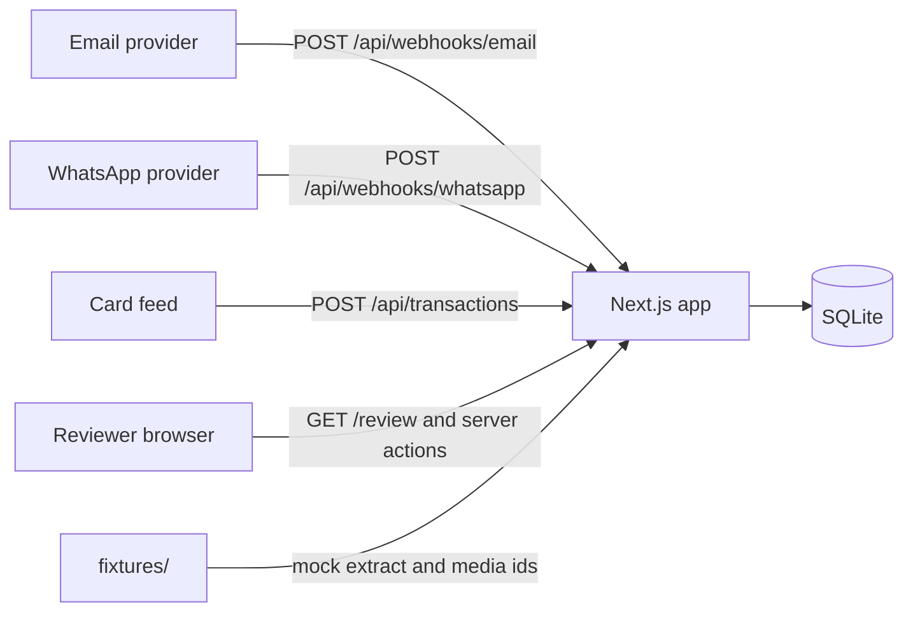

# A. Architecture summary

Darb's clients must attach a receipt or a tax invoice to every card charge so a VAT filing has evidence. Drivers send receipt photos on WhatsApp. Suppliers email tax invoices. A person used to open each file and search the card feed. This app accepts those files, reads them with a mocked extractor, and attaches a document to one charge when the match is clear. Ambiguous, risky, and missing matches wait.

## Actors, inputs, outputs

| Actor | How they show up | What they send | What they get back |
| --- | --- | --- | --- |
| Email inbound-parse provider | `POST /api/webhooks/email` | `messageId`, `from`, `to`, `subject`, `receivedAt`, `attachments[]` | `200` `{ documents: [{ documentId, result }] }`, `400`, or `503`. The match outcome is in the database, not the body. |
| WhatsApp provider, simplified | `POST /api/webhooks/whatsapp` | Meta-like envelope. Image messages carry `id`, `from`, `timestamp`, `image.id`. | Same document response. A bad message inside a valid envelope is skipped and the route still returns `200` with the documents that were stored. |
| Card feed | `POST /api/transactions` | `{ transactions: [{ externalRef, clientId, cardLast4, merchantName, amount, transactionAt, driverPhone? }] }` | `{ transactions: [{ transactionId, result: created \| duplicate }] }`. Rematch runs in this request, before the response. |
| Ops reviewer | `/review` | Confirm or reject one `matchId` | The page reloads from SQLite. There is no signed-in user. `decidedBy` is the constant `reviewer`. |
| Driver and supplier | Not users of the app | They appear only as `senderIdentifier` | No driver UI. |

Seeded actors: client 1 Northline Logistics (`billing@alfanar-fuel.com.sa`, driver `+966551234567`), client 2 Red Sea Haulage. Fifteen charges live in `prisma/seed.ts`. Transaction 1 is the exact Alfanar charge of 12500 halalas (125.00 SAR). Transactions 2 and 3 are the same-day Albaik pair of 4800. Transaction 4 is the Chef's Table charge of 6325. Transaction 5 is client 2's twin of transaction 1.

## Invariants

1. One stored file is one `Document`. Email `externalId` is `messageId#attachmentIndex`. WhatsApp `externalId` is the message id. Both are globally unique.
2. The same bytes from the same sender are one document. Uniqueness is `(scope, contentHash)`, not the hash alone. Scope is `EMAIL:<lowercase address>` or `WHATSAPP:<E.164>`.
3. A document may be scored only against its sender scope. Email: that client's transactions. WhatsApp: that driver's phone. Scope is a filter. It is not a fifth weight.
4. Amounts are integer halalas. 57.50 SAR is `5750`.
5. At most one `CONFIRMED` or `AUTO_CONFIRMED` `DocumentMatch` per transaction, and at most one per document. Both rules are partial unique indexes in `prisma/migrations/20261015113000_init/migration.sql`. Prisma's schema language cannot express them.
6. A transaction that already has a confirmation is not auto-attached to a second document. That second document goes to review.
7. The webhook response does not wait for extraction. A throwing extractor still returns `200`. The row becomes `FAILED`.
8. Confirm and reject accept `{ matchId }` only. The browser does not decide the new status.

## Requirements you will be asked about

Must-haves, grouped:

- Inbound: FR-001 email, FR-002 WhatsApp, FR-003 Zod and 400, FR-004 message idempotency, FR-005 content-hash idempotency, FR-006 fast webhook, FR-007 terminal failure states, FR-008 `MediaStore`, FR-009 sender scope.
- Extraction: FR-010 `DocumentExtractor`, FR-011 hash-keyed mock, FR-012 six fixtures.
- Data: FR-013 status enums, FR-014 seed.
- Matching: FR-015 pure `matchDocument`, FR-016 four signals plus scope, FR-017 weights written in `IMPLEMENTATION.md`, FR-018 auto-match, FR-019 review, FR-020 unmatched, FR-021 already confirmed, FR-022 through FR-027 the six edges.
- Review: FR-028 confirm, FR-029 reject, FR-030 double submit, FR-031 database uniqueness.
- Proof: FR-032 matcher tests, FR-033 ingestion tests, FR-034 README, FR-035 `IMPLEMENTATION.md`.

Non-functional: strict TypeScript (NFR-001), no `any` (NFR-002), Zod at the edges (NFR-003), stored signal breakdown (NFR-004), one bad document does not fail the HTTP response (NFR-005), prefer a person over a wrong VAT attachment (NFR-006).

Constraints that shape the design: Next.js 15 App Router (CON-001), Prisma 6 and SQLite (CON-002), next-safe-action 8 (CON-003), Zod 3 (CON-004), Jest 29 (CON-005), integer halalas (CON-006), integer primary keys (CON-012).

Built bonuses: `/review` (BON-001), rematch when a charge arrives (BON-002), and a local Tesseract extractor that stays off unless `EXTRACTOR=tesseract` (BON-004). Sketch only: multi-invoice statements (BON-003). Deferred: HMAC (BON-005).

The assignment grades roughly matcher 30%, pipeline 25%, data model 20%, type safety 15%, tests 10%.

## Runtime picture

One Next.js process. One SQLite file, resolved by `getPrisma()` in `lib/prisma.ts` through `resolveSqliteUrl` so `file:./dev.db` means `prisma/dev.db`. No queue, no cache, no worker, no blob store, no SMTP, no Meta Graph call, no OCR vendor.



Document path:

```txt
webhook route -> document-ingestion -> after() -> document-processing -> matchDocument -> match-persistence
```

Charge path:

```txt
POST /api/transactions -> acceptTransactions -> store charge -> rematchForCharges -> matchDocument -> applyRematch
```

Review path:

```txt
app/review/page.tsx -> loadReviewDesk -> ReviewBoard -> confirmMatch / rejectMatch -> confirmMatchDecision / rejectMatchDecision
```

## Why the shape fits the assignment

The graded risk is a wrong auto-attachment and a duplicate document, not throughput. A pure matcher (`lib/services/transaction-matcher.ts`) can be tested with plain objects. The database, not the page, enforces one confirmation. `after()` lets the provider get `200` before a slow extract. SQLite and fixture files are enough for a reviewer who has no API keys.

What would change in production is listed at the end of [04-lifecycles.md](04-lifecycles.md) under each choice, and collected in [07-reviewer-questions.md](07-reviewer-questions.md).
