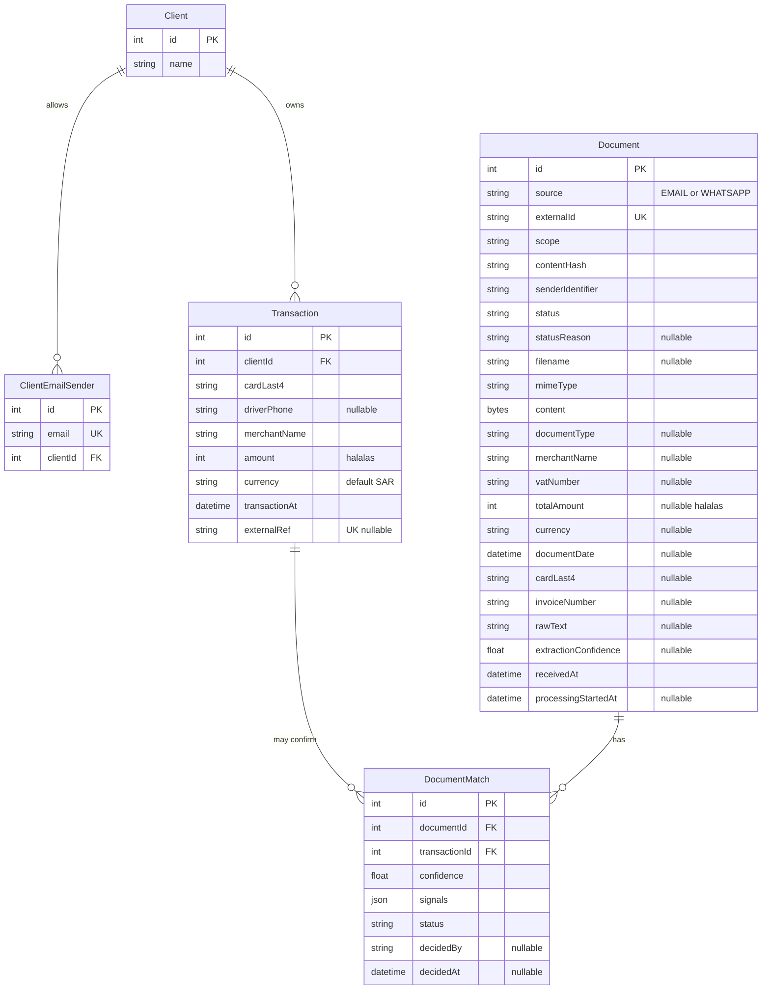
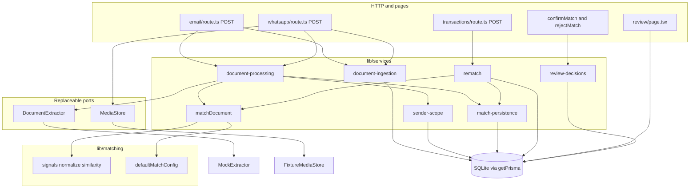

# C. Data model

Source: `prisma/schema.prisma` and the two SQL migrations. Amounts are `Int` halalas. Primary keys are integers. Enums are stored as SQLite text.



## Relations in words

- A `Client` has many mailboxes and many charges.
- `ClientEmailSender.email` is unique. The seed stores already-lowercased addresses. The email Zod schema lowercases `from` before lookup.
- A `Transaction` belongs to one client. `driverPhone` is optional. Late charges set it when the payload has a phone. Seeded phones are E.164.
- A `Document` has many `DocumentMatch` rows. Bytes live on `Document.content`. There is no blob table.
- `DocumentMatch` is the attachment attempt. `@@unique([documentId, transactionId])` stops the same pair being inserted twice. `signals` is `{ signals, flags }`, written by `signalValue` in `lib/services/match-persistence.ts`.

## Indexes the schema file does not show

From `prisma/migrations/20261015113000_init/migration.sql`:

```sql
CREATE UNIQUE INDEX "DocumentMatch_one_confirmed_per_transaction"
  ON "DocumentMatch"("transactionId") WHERE "status" IN ('CONFIRMED', 'AUTO_CONFIRMED');
CREATE UNIQUE INDEX "DocumentMatch_one_confirmed_per_document"
  ON "DocumentMatch"("documentId") WHERE "status" IN ('CONFIRMED', 'AUTO_CONFIRMED');
```

`CANDIDATE` and `REJECTED` rows are not in those indexes, so several documents can point at the same open charge, and one document can list several candidates.

Also unique:

- `Document.externalId`
- `Document (scope, contentHash)` — DEV-001. The gist sample made `contentHash` globally unique. This project does not.
- `Transaction.externalRef` — added in the second migration. Nulls are allowed, so the 15 seed rows stay valid.

## Document versus match

| | Document | DocumentMatch |
| --- | --- | --- |
| Question it answers | What file arrived, and where is it in the pipeline? | Which charge was considered, and did anyone attach it? |
| Status enum | `RECEIVED`, `EXTRACTED`, `MATCHED`, `NEEDS_REVIEW`, `UNMATCHED`, `FAILED` | `CANDIDATE`, `AUTO_CONFIRMED`, `CONFIRMED`, `REJECTED` |
| Who writes it | Ingestion inserts. Processing, rematch, and review decisions update. | `persistOutcome`, `applyRematch`, `confirmMatchDecision`, `rejectMatchDecision`. |

`AUTO_MATCHED` is a matcher outcome. It is not a document status. Persistence maps it to document `MATCHED` and match `AUTO_CONFIRMED`.

# D. Component diagram

This is the code that exists, not a planned sketch.



Dependency direction: routes and pages call services. Services call the matcher, the ports, and Prisma. `lib/matching` and `transaction-matcher.ts` do not import `lib/prisma` or other services. The purity test locks that. An ESLint import rule was planned and is not present.

`review/page.tsx` calls `loadReviewDesk` in `lib/review/queue.ts`, which uses Prisma directly. It does not call `review-decisions`. Only the server actions do.
