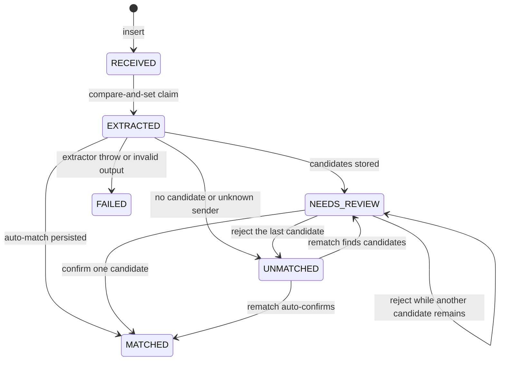
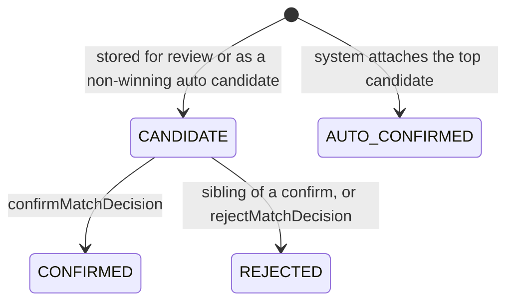

# Lifecycles and the choices behind them

## Document status

`EXTRACTED` is a lease, not a business outcome. `isTerminal` in `document-processing.ts` treats `MATCHED`, `NEEDS_REVIEW`, `UNMATCHED`, and `FAILED` as finished, so a later `processDocument` returns immediately.

`statusReason` is a string, not an enum. Values you should recognize:

| Reason | When |
| --- | --- |
| `AUTO` | Auto-match persisted. |
| `AMBIGUOUS` | Top two scores are within 0.10. |
| `ALREADY_CONFIRMED` | Winner already has a confirmation, or the unique index rejected the auto-confirm. |
| `TIP` | Charge is above the receipt by at most 20%. |
| `CARD_MISMATCH` | Both cards are present and differ. |
| `DATE_DISAGREES` | A present date scores 0. |
| `LOW_EXTRACTION_CONFIDENCE` | OCR confidence is below 0.60. |
| `BELOW_THRESHOLD` | Best score is under 0.85 and no stronger block applied. |
| `NO_CANDIDATE` | Nothing cleared the 0.50 floor inside scope. |
| `UNKNOWN_DOCUMENT` | `documentType` is `UNKNOWN`. |
| `AMOUNT_UNUSABLE` | Amount is null, not an integer, or not positive. |
| `UNKNOWN_SENDER` | Email is not in `ClientEmailSender`, or the phone matches no `Transaction.driverPhone`. The matcher is not called. |
| `ALL_CANDIDATES_REJECTED` | The reviewer rejected the last open candidate. |
| `REVIEWER_CONFIRMED` | The reviewer confirmed. |
| `UNREADABLE`, `INVALID_OUTPUT`, `EXTRACTION_FAILED` | `markFailed`. |

## Match status

There is no transition out of `CONFIRMED`, `AUTO_CONFIRMED`, or `REJECTED`. A second confirm returns `ALREADY_CONFIRMED`. A reject of a confirmation returns `CONFLICT` and does not undo it. A confirm of a `REJECTED` row returns `ALREADY_REJECTED`.

On an auto-match, `writeMatches` marks index 0 `AUTO_CONFIRMED` with `decidedBy = 'system'` and any later ranked rows `CANDIDATE`. The auto path usually has one survivor above the gates, so you normally see one `AUTO_CONFIRMED` row. If the partial index rejects that insert, the transaction rolls back and `persistOutcome` retries with `forceReview`: every row stays `CANDIDATE`, and the document becomes `NEEDS_REVIEW` / `ALREADY_CONFIRMED`.

## How a file gets in

### Email

`handleEmailPost` in `app/api/webhooks/email/route.ts`.

1. `ingestEmailRequest` reads the body. Over `MAX_EMAIL_BODY_CHARS` or invalid JSON is `400` `INVALID_JSON` or `INVALID_PAYLOAD`. Nothing is stored.
2. `emailPayloadSchema` checks the sample shape. `from` is trimmed and lowercased.
3. Each attachment must be `application/pdf`, `image/jpeg`, `image/png`, or `image/webp`, judged by the declared `contentType`. Base64 is decoded. Decoded size is capped at 10 MiB. Any attachment problem fails the whole request with `400`.
4. `externalId` is `${messageId}#${index}`. `contentHash` is SHA-256 of the decoded bytes. `scope` is `emailScope(from)`, which is `EMAIL:` plus that already-lowercased address.
5. `saveReceivedDocument` looks up `externalId` or `(scope, contentHash)`. A hit returns `duplicate`. A create inserts `RECEIVED` with the bytes on `content`. A unique-constraint race (`P2002`) reads the winner and returns `duplicate`.
6. Only ids still in `RECEIVED` are passed to `schedule`. The route's schedule calls Next.js `after(() => processDocument(...))`.
7. The HTTP body is `{ documents: [{ documentId, result: 'created' | 'duplicate' }] }`. An insert error that is not a unique conflict is `503` `{ error: 'STORE_FAILED' }`.

The sample `fixtures/webhooks/email-exact.json` is the synthetic Alfanar invoice. On a seed database it becomes document status `MATCHED`, reason `AUTO`, one `AUTO_CONFIRMED` match on transaction 1, confidence 1, `decidedBy` `system`.

### WhatsApp

`handleWhatsAppPost`. Envelope Zod failures are `400`. Per-message problems are skipped, the route returns `200`, and that message is not stored.

Skipped reasons, pushed by `prepareWhatsAppMessage`: `NOT_IMAGE`, `INVALID_PHONE`, `INVALID_TIMESTAMP`, `UNKNOWN_MEDIA`, `UNSUPPORTED_MEDIA`, `EMPTY_MEDIA`, `OVERSIZE`.

`normalizePhone` strips spaces, dashes, dots, and parentheses. A leading `+` or `00` is a country code. A Saudi mobile `05XXXXXXXX` becomes `+9665XXXXXXXX`. `966551234567`, `+966551234567`, `00966551234567`, and `0551234567` all become `+966551234567`. Anything else that is not 8 to 15 digits is invalid. No other country is assumed from a local format.

`FixtureMediaStore.get(image.id)` loads bytes. The payload `sha256` is not the stored hash. The stored hash is SHA-256 of those bytes. `externalId` is the message id. Scope is `WHATSAPP:+966...`.

A phone that normalizes and matches no driver is stored. Processing then sets `UNMATCHED` / `UNKNOWN_SENDER`. An unknown media id is not stored, because a document row requires bytes and the hash is of those bytes.

### Processing, shared by both webhooks

`processDocument` in `lib/services/document-processing.ts`.

1. Load the row. Missing or terminal: return.
2. `updateMany` where `status = RECEIVED` sets `EXTRACTED` and `processingStartedAt`. That is the claim.
3. If the claim count is 0, a second `updateMany` may take an `EXTRACTED` row whose `processingStartedAt` is null or older than 5 minutes (`CLAIM_MS`). If that also fails, return. Two overlapping workers do not both extract.
4. `extractor.extract(bytes, mimeType)`, then `parseExtractedDocument`. `ExtractionError` or any other throw calls `markFailed` while status is still `EXTRACTED`. Reason is the error code, or `EXTRACTION_FAILED`.
5. WhatsApp: if `transaction.count({ driverPhone })` is 0, `saveUnknownSender`. Otherwise load that phone's charges and call `matchDocument` with `{ kind: 'WHATSAPP', driverPhone }`.
6. Email: `findEmailClient`. Unknown mailbox: `saveUnknownSender`. Otherwise load that `clientId` and call `matchDocument` with `{ kind: 'EMAIL', clientId }`.
7. `loadCandidates` also sets `hasConfirmedDocument` when the charge already has a `CONFIRMED` or `AUTO_CONFIRMED` match. The query is scoped, and `inScope` inside the matcher checks again.
8. `persistOutcome` writes extraction columns, document status, and match rows in one `$transaction`. It refuses to overwrite a row that is already terminal. A reviewer decision that landed first is kept.

`toExtractedFields` is the cut between OCR and scoring. VAT, invoice number, and `rawText` are stored on the document and never scored.

The route's `after()` callback catches processing errors and logs the error name. Those errors do not change the HTTP response, which has already been produced. A crash after the claim and before `persistOutcome` can leave `EXTRACTED`. Redelivery does not schedule that row, because `storeDrafts` schedules only `RECEIVED`. The reclaim branch never runs unless something calls `processDocument` again. That is audit finding P2-1. A crash before the claim leaves `RECEIVED`, and the same message is scheduled again.

## How the matcher decides

`matchDocument(doc, transactions, scope, config = defaultMatchConfig)`.

1. `UNKNOWN` -> `UNMATCHED` / `UNKNOWN_DOCUMENT`. Unusable amount -> `UNMATCHED` / `AMOUNT_UNUSABLE`. No throw.
2. Drop duplicate transaction ids, out-of-scope rows, non-positive amounts, bad timestamps, and unknown currencies. A blank document currency is SAR. A pegged cross-currency pair is converted for the amount score and flagged `FX`. A pair with no peg is dropped.
3. `scoreAmount`. Equal is 1. Within `max(5 halalas, 1% of the document amount)` is 0.9 and is not a tip. A charge above the receipt by at most 20% is 0.5 and flag `TIP`. Anything else, including a charge below the receipt outside the rounding band, drops the candidate. Rounding is checked before the tip. A 15% gap is inside 20%, so it is a tip. There is no pre-VAT rule (ASM-005).
4. A present merchant below 0.25 drops the candidate even if the card matches. A missing merchant omits the signal.
5. Card: both present and equal is 1. Both present and different is 0 and flag `CARD_MISMATCH`. Either missing omits the signal.
6. Date: Riyadh calendar day, UTC+3, no daylight saving (ASM-001). Same day is 1. A gap of 1 to 7 days is `1 - dayGap / 8`. Day 8 and after is 0. A missing date omits the signal. `21:00 UTC` on 14 Jun 2025 is 15 Jun in Riyadh.
7. `hasConfirmedDocument` adds flag `ALREADY_CONFIRMED`. It does not drop the candidate.
8. `combineSignals` is a weighted mean of the signals that exist, times `min(1, availableWeight / 0.75)`, then `round4`. Weights: amount 0.40, merchant 0.25, card 0.20, date 0.15.
9. Keep confidence at least 0.50, sort by confidence descending then transaction id ascending, keep 5.
10. No survivor -> `UNMATCHED` / `NO_CANDIDATE`.
11. Auto-match only when the top score is at least 0.85, the lead over the next is greater than 0.10, extraction confidence is at least 0.60, and the top candidate is not blocked. Blocks: `TIP`, `CARD_MISMATCH`, `ALREADY_CONFIRMED`, a present date score of 0. A missing date does not block.
12. Otherwise `NEEDS_REVIEW`, with a reason chosen in this order: ambiguous, already confirmed, tip, card mismatch, date disagrees, low extraction confidence, below threshold.

Amount alone cannot look certain. Weight 0.40 over a coverage floor of 0.75 is about 0.5333, which can reach review and cannot auto-match.

Worked edges, from `IMPLEMENTATION.md` and the matcher tests:

| Situation | Result |
| --- | --- |
| Exact amount, merchant, day, and card | `AUTO_MATCHED`, confidence 1 |
| Exact amount and merchant, no card, same day | `AUTO_MATCHED` |
| Exact amount, merchant, and card, date missing | `AUTO_MATCHED` |
| Albaik, two charges of 48.00 SAR on 12 Jun 2025 | `NEEDS_REVIEW`, both ids, lower id first |
| Receipt 57.50 SAR, charge 63.25 SAR | `NEEDS_REVIEW`, amount 0.5, flag `TIP` |
| Same charge already confirmed | `NEEDS_REVIEW` |
| Only the other client's twin is in scope | `UNMATCHED` |
| Date 7 days away, everything else exact | `AUTO_MATCHED`, date score 0.125 |
| Date 8 or more days away, everything else exact | `NEEDS_REVIEW` |

Merchant text is Latin. `normalizeMerchant` lowercases, strips accents, drops `ruh`, `jed`, `dmm`, `riyadh`, `llc`, `co`, `est`, and pure numbers, and maps `st` to `station`. Arabic names are not folded.

## Confirm and reject

`confirmMatch({ matchId })` and `rejectMatch({ matchId })` in `lib/actions/review.ts` validate with Zod, call the service, and `revalidatePath('/review')`.

`confirmMatchDecision`:

1. Inside one `$transaction`, `updateMany` the row only where `status = CANDIDATE`, setting `CONFIRMED`, `decidedBy`, `decidedAt`.
2. Count 0: `classify` returns `NOT_FOUND`, `ALREADY_CONFIRMED`, `ALREADY_REJECTED`, or `CONFLICT`.
3. Load the match. `inScope` checks the WhatsApp phone or the email mailbox's `clientId`. Out of scope throws `DecisionConflict`, the transaction rolls back, the caller gets `CONFLICT`.
4. Other `CANDIDATE` rows on that document become `REJECTED`.
5. `updateMany` the document from `NEEDS_REVIEW` to `MATCHED` / `REVIEWER_CONFIRMED`. If the document is no longer in review, roll back.
6. A `P2002` from the partial unique index becomes `CONFLICT`. The second confirmation of the same transaction does not commit.

`rejectMatchDecision`:

1. `updateMany` from `CANDIDATE` to `REJECTED`. Count 0 uses `classify`. Rejecting a confirmation is `CONFLICT`.
2. If the document is `NEEDS_REVIEW` and no `CANDIDATE` remains, set `UNMATCHED` / `ALL_CANDIDATES_REJECTED`.
3. If another candidate remains, the document stays `NEEDS_REVIEW`.

The page does not withdraw candidates on other documents. REC-003 was left unimplemented on purpose. The unique indexes still stop a second confirmation. The reviewer can reject the leftover candidate. Confirm is hidden when `transaction.documents` already contains a confirmation, via `candidateActions`.

## How a transaction enters, and what it does to old receipts

`POST /api/transactions` calls `acceptTransactions` in `lib/services/rematch.ts`. This path does not use `after()`.

1. Zod. `amount` is a positive integer. `cardLast4` is 4 digits. `driverPhone` is optional and goes through `normalizePhone`.
2. Unknown `clientId` is `400`. Store failures are `503`.
3. `storeOne` returns the existing row when `externalRef` already exists and does not update it. A `P2002` race does the same.
4. `rematchForCharges` loads `UNMATCHED` documents whose email sender belongs to one of the new charges' clients, or whose WhatsApp sender equals one of the new charges' driver phones.
5. It does not reopen `MATCHED`, `NEEDS_REVIEW`, `FAILED`, or `RECEIVED`.
6. `fieldsFromDocument` rebuilds `ExtractedFields` from saved columns. `UNKNOWN`, a null or non-positive amount, or a null extraction confidence is skipped. Bytes are not extracted again.
7. Transactions the document already `REJECTED` are removed before `matchDocument`.
8. `applyRematch` updates a document only while it is still `UNMATCHED`. It deletes `CANDIDATE` rows, keeps `REJECTED` rows, and inserts fresh pairs. A lost auto-confirm is saved as `NEEDS_REVIEW` / `ALREADY_CONFIRMED`.
9. Two early receipts for one new charge: one becomes `AUTO_CONFIRMED`. The other goes to review. The partial index is what splits them.

Each charge is committed in `storeOne` before rematch. If rematch throws, the route returns `503` even though the charge row exists. Posting the same `externalRef` again returns `duplicate` and runs rematch again. That retry is safe because rematch only moves `UNMATCHED` documents.

## How the review UI reaches the decision

`app/review/page.tsx` is a server component. `tab=unmatched` selects the second list. Anything else is Needs review.

`loadReviewDesk` loads both statuses in one query, oldest `receivedAt` first, matches ordered by confidence descending then id ascending. It does not select file bytes or `rawText`. Amounts go through `formatHalalas` (`12500` and `SAR` become `SAR 125.00`). Dates use `Asia/Riyadh`. Missing extraction is the string `Not extracted`. The card says no preview is shown.

`ReviewBoard` is a client component. It calls `executeAsync({ matchId })`. A `useRef` lock plus disabled buttons cover the in-flight request. `outcomeFromAction` shows success copy only for `CONFIRMED` and `REJECTED`. `CONFLICT`, `ALREADY_CONFIRMED`, `ALREADY_REJECTED`, `NOT_FOUND`, validation errors, and `REVIEW_FAILED` stay on the page and tell the reviewer the decision was not saved or that they should refresh. After any returned `data`, `router.refresh()` reloads the server component.

Unmatched documents are rendered with `canConfirm` and `canReject` forced false, including a leftover `CANDIDATE`, because confirm requires document status `NEEDS_REVIEW`.

## Architectural choices

### Pure matcher

Decision: `matchDocument` receives fields, transactions, scope, and config. Callers load rows.

Problem: the graded logic has to be deterministic and explainable.

Why it fits: the six edges are plain objects. `__tests__/matching/` never opens SQLite. Ingestion tests are forbidden from mocking `matchDocument`, so the pipeline still proves the real function.

Alternatives: score inside the route, or let the matcher query Prisma.

Trade-off: the caller can pass the wrong set. Processing and rematch both filter, and `inScope` checks again. The function cannot see a confirmation that the caller forgot to flag. `hasConfirmedDocument` is an input.

Production: the same function stays. The candidate query grows a date window when the table is large. Thresholds move from confirm and reject rates. There is no labelled set in this repo.

### Shared ingestion and processing

Decision: email and WhatsApp prepare different drafts, then both call `storeDrafts` and `processDocument`.

Problem: idempotency, the claim, and the match write must not drift between channels.

Why it fits: FR-004 and FR-006 are one implementation. Channel differences stay at the edge: base64 versus `MediaStore`, mailbox versus phone, fail-the-request versus skip-the-message.

Alternatives: two pipelines, or one generic webhook.

Trade-off: WhatsApp skip reasons and email 400s are easy to confuse in a review. Learn the table above.

Production: put HMAC in each route, before Zod, over the raw body. Keep one processing function.

### `after()` and bytes on the row

Decision: insert `RECEIVED`, respond, process in `after()`. Bytes live on `Document.content`. ADR 0006.

Problem: a slow extract must not make the provider time out and retry, and a crash must not lose the file.

Why it fits: one SQLite file is the whole system. Tests pass a Prisma client and call `processDocument` directly. Only the route calls `after()`.

Alternatives: extract inside the request, keep bytes only in the closure, a blob directory, a queue and worker.

Trade-off: `after()` is best-effort. SQLite rows hold blobs, capped at 10 MiB. There is no cron. P2-1 is the stuck `EXTRACTED` row.

Production: a queue with a visibility timeout, object storage, and a redelivery rule that resumes a stale `EXTRACTED` row. Do not add that queue to this exercise unless asked.

### Database uniqueness

Decision: two partial unique indexes, plus guarded `updateMany`. ADR 0005.

Problem: two confirms, or an auto-match racing a confirm, can both pass an application check.

Why it fits: FR-031 asks for a database rule. The schema tests and the concurrent ingestion tests use real SQLite writes.

Alternatives: application checks only, a `matchedDocumentId` column on `Transaction`, an index on the transaction only.

Trade-off: Prisma may want to drop the hand-written SQL on a later `migrate dev`. The schema test is the guard. The per-document index would have to be dropped before one statement could confirm several charges. BON-003 says that and does not implement it.

Production: the same constraints in Postgres. Keep the application `CONFLICT` so the UI gets a typed result instead of a raw constraint error.

### Integer money

Decision: `Transaction.amount` and `Document.totalAmount` are `Int`. `formatHalalas` uses integer division.

Problem: binary floating point will mis-compare 57.50 and 63.25, and VAT evidence cannot be off by a halala.

Why it fits: CON-006. The tip and rounding bands are integer comparisons in `scoreAmount`.

Alternatives: decimal strings, floating SAR.

Trade-off: every display site must divide by 100. A float that reaches `formatHalalas` renders as `Not extracted` (`12.5` is covered by the format test).

Production: keep minor units. Do not switch the matcher to floats.

### Server-side validation

Decision: Zod on both webhooks, the charge feed, and `matchIdSchema`. Actions use `.inputSchema()` because next-safe-action 8.7.3 deprecates `.schema()` (DEV-005).

Problem: the body is untrusted, and the page can be stale.

Why it fits: NFR-003. A confirm that is not a positive integer never reaches `confirmMatchDecision`. The decision function still checks `CANDIDATE`, scope, and document status.

Alternatives: trust the buttons, or validate only in the client.

Trade-off: the UI also hides illegal buttons so the reviewer is not offered a click that will conflict. That hide is a courtesy. A forged `{ matchId }` still hits the service.

Production: add session auth in front of the actions and set `decidedBy` from that session. ASM-006 says this exercise has none.

### Test isolation

Decision: matcher tests are pure. Schema and ingestion tests use `.test-db/` and `prisma migrate deploy`. `npm test` is `--runInBand`.

Problem: SQLite has one writer. A shared `prisma/dev.db` would flake and would destroy the development rows.

Why it fits: the assignment's testing grade is the edges, the redelivery, and the failed extract. Concurrent tests can prove the partial index because they use a real database.

Alternatives: mock Prisma, or mock `matchDocument` inside ingestion tests. Both are rejected. The ingestion suite must call the real matcher. The matcher suite must not open a database.

Trade-off: the suite is slower and must stay single-worker. `npx jest` without `--runInBand` can collide. There is no browser test. The 15 Oct 2026 click-through used `.test-db/review-ui.db` and is written in `README.md`.

Production: the pure matcher tests stay. Integration tests move to Postgres with a migrated schema per worker.

### Sender scope as a filter

Decision: drop out-of-scope rows before scoring. ADR 0007 adds `Client` and `ClientEmailSender` because the sample schema has no email-to-client map.

Problem: a cross-client twin with the same amount, merchant, and card must not receive a partial score.

Why it fits: FR-009. Transaction 5 is that twin. Unknown senders are stored as `UNMATCHED` / `UNKNOWN_SENDER` so the file is not dropped on the floor.

Alternatives: a fifth weight, hard-coded seed map, or refusing to store an unknown sender.

Trade-off: a bad sender can fill SQLite. The 10 MiB cap is the limit in this exercise.

Production: an allowlist and a rate limit. Keep the filter. Do not turn scope into a soft score.

### Idempotency keys

Decision: ADR 0003. Message identity and content hash are both checked. The hash is scoped per sender.

Problem: providers redeliver, one email has many attachments, and two fleets can submit the same photo.

Why it fits: FR-004 and FR-005. `findExisting` checks both keys. The unique indexes close the race.

Alternatives: global `contentHash`, or hash only.

Trade-off: a grader comparing the schema to the gist will see DEV-001 and DEV-002. Say them out loud. Same bytes from two senders are two documents. That is intentional.

Production: the same keys, plus the provider's signature so a stranger cannot invent a `messageId`.
