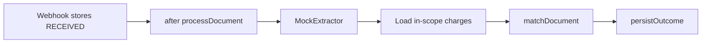
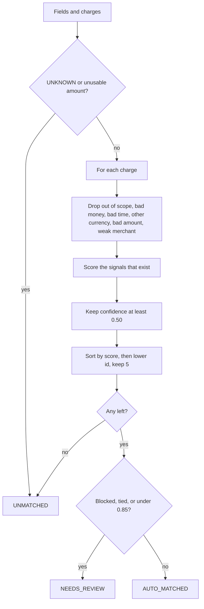
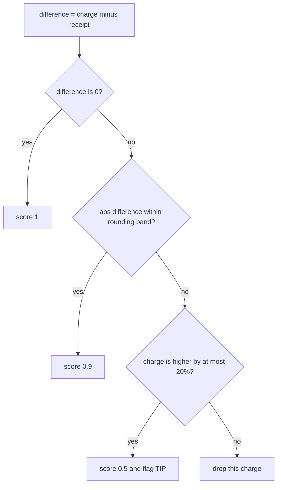

# Matcher engine

The heart of the system. Read this until you can recompute one example on paper. Code: `lib/services/transaction-matcher.ts`, `lib/matching/signals.ts`, `lib/matching/config.ts`. Tests: `__tests__/matching/transaction-matcher.test.ts`.

`matchDocument` does not see the database, the clock, or the file. Processing loads charges and passes them in. The function returns a decision and a ranked list. Persistence turns that decision into rows.

## The job in one sentence

Given one receipt and the charges this sender is allowed to see, either attach it to one charge, or hand a short ranked list to a person, or say nothing was close.

A wrong attachment files the wrong VAT evidence. An extra review costs one click. The gates are built so the click wins whenever the money story is imperfect.

## Where it sits



Email scope is `{ kind: 'EMAIL', clientId }`. WhatsApp scope is `{ kind: 'WHATSAPP', driverPhone }` after the phone is already E.164. Scope is applied before any score. It is not a fifth weight. Client 2's copy of the Alfanar charge never receives 0.4 for amount.

The matcher also refuses to score a charge twice if the same id appears twice in the array.

## What goes in and what comes out

Input document, `ExtractedFields` from `toExtractedFields`:

| Field | Used as |
| --- | --- |
| `documentType` | `UNKNOWN` stops immediately. `RECEIPT` and `TAX_INVOICE` continue. |
| `totalAmount` | Integer halalas. Null, zero, or a float such as `12.5` stops immediately. |
| `merchantName` | Fuzzy name. Null means the signal is skipped. |
| `cardLast4` | Exact last 4 when both sides have digits. |
| `documentDate` | Calendar day. Null or unreadable means the signal is skipped. |
| `currency` | Blank means SAR. The same ISO currency is scored in its minor units and can auto-match. A pegged cross (USD and SAR at 3.75) is converted only for the score, flagged `FX`, and cannot auto-match. No peg, or an unknown code, drops the charge. |
| `extractionConfidence` | Gate on the whole decision. Not one of the four weights. |

VAT number, invoice number, and raw text are stored on `Document` and never passed in.

Input charge, `CandidateTransaction`: id, clientId, driverPhone, merchantName, amount, currency, transactionAt, cardLast4, `hasConfirmedDocument`.

Output:

| `outcome` | Meaning | Stored later as |
| --- | --- | --- |
| `AUTO_MATCHED` | One clear winner | Document `MATCHED`, top match `AUTO_CONFIRMED`, `decidedBy` `system` |
| `NEEDS_REVIEW` | People must look | Document `NEEDS_REVIEW`, every survivor `CANDIDATE` |
| `UNMATCHED` | Nothing usable | Document `UNMATCHED`, no match rows |

`candidates` on a review or auto result is the ranked list, best first, at most 5. On `UNMATCHED` it is empty.

## The pipeline inside the function



Order matters. A charge is thrown away before it can earn a high score from the card alone. The auto gates run only after ranking, and they look at the top row.

## Every parameter

All of these live in `defaultMatchConfig` in `lib/matching/config.ts`. A test can pass a different config. Production callers do not.

| Parameter | Value | What it does |
| --- | --- | --- |
| `weights.amount` | 0.40 | Share of the average given to the money score. |
| `weights.merchant` | 0.25 | Share given to the name score. |
| `weights.cardLast4` | 0.20 | Share given to the card score. |
| `weights.date` | 0.15 | Share given to the day score. |
| `coverageFloor` | 0.75 | If the signals you actually have weigh less than this, shrink the confidence. |
| `autoThreshold` | 0.85 | Top confidence must reach this to attach with no person. |
| `tieMargin` | 0.10 | If the top leads the second by this much or less, a person chooses. |
| `reviewFloor` | 0.50 | Scores under this are not shown. |
| `maxCandidates` | 5 | Cap on the list. Extra ties are dropped, lowest ids kept. |
| `minExtractionConfidence` | 0.60 | OCR's own confidence. Below this, no auto-attach. 0.60 is allowed. |
| `merchantMinimum` | 0.25 | A present name below this deletes the charge. |
| `tipRatio` | 0.20 | Card may be up to 20% above the receipt and still be a candidate. |
| `roundingHalalas` | 5 | Smallest money band: 0.05 SAR. |
| `roundingRatio` | 0.01 | Or 1% of the receipt, if that is larger. |
| `dateZeroFromDays` | 8 | Day 8 and later score 0 and block auto-attach. |
| `dateDivisor` | 8 | Day gap of 1 to 7 scores `1 - gap / 8`. |

Weights sum to 1. That is convenient, and it is not what makes a partial document safe. Coverage does that.

## The confidence formula

For each signal that exists:

```txt
mean = (weight1 * score1 + weight2 * score2 + ...) / (weight1 + weight2 + ...)
coverage = min(1, availableWeight / 0.75)
confidence = round4(mean * coverage)
```

`round4` is `Number(value.toFixed(4))`. Comparisons use the rounded value.

A missing signal is left out of both the numerator and the denominator. It is not a zero. A zero that we did compute, such as a card mismatch or a date 8 days away, stays in the average and also becomes a hard block.

Worked coverage, amount only, score 1:

```txt
availableWeight = 0.40
mean = 1
coverage = min(1, 0.40 / 0.75) = 0.5333
confidence = 0.5333
```

0.5333 is above the review floor and below 0.85, so the result is `NEEDS_REVIEW` / `BELOW_THRESHOLD`. One strong fact cannot look like a full match. That is the reason amount can be the heaviest weight without being allowed to decide alone.

Three exact signals and a missing date:

```txt
weights used = 0.40 + 0.25 + 0.20 = 0.85
coverage = min(1, 0.85 / 0.75) = 1
confidence = 1
```

That auto-matches. 0.85 of weight is enough coverage. The assignment treats a missing date as "OCR failed," not as "the days disagree."

## Signal by signal

### Amount

`difference = charge - receipt`, both halalas. `scoreAmount` in `lib/matching/signals.ts`.



Rounding band = `max(5, 1% of the receipt)`. It is checked before the tip. It is symmetric: a few halalas either way is still 0.9 and is not a tip.

| Receipt | Charge | Difference | Band | What happens |
| --- | --- | --- | --- | --- |
| 12500 (125.00 SAR) | 12500 | 0 | 125 | Score 1 |
| 10000 (100.00) | 10005 | +5 | 100 | Score 0.9. With the other signals exact, confidence 0.96, auto-match |
| 5750 (57.50) | 6325 (63.25) | +575 | 57.5 | 575 is inside 20% of 5750, which is 1150. Score 0.5, flag `TIP` |
| 10000 | 11500 | +1500 | 100 | 1500 is 15% and the tip limit is 2000. Score 0.5, flag `TIP` |
| 10000 | 9800 | -200 | 100 | Charge is lower, outside the band. Dropped |
| 10000 | 12501 | +2501 | 100 | More than 20% higher. Dropped |

The Chef's Table case with every other signal exact:

```txt
amount 0.5, merchant 1, card 1, date 1
mean = 0.40*0.5 + 0.25 + 0.20 + 0.15 = 0.80
confidence = 0.8000
```

0.80 is already under 0.85. The `TIP` flag would block auto-match even if a future weight change pushed the number over the line. With today's weights, a tip cannot reach 0.85 while the other present signals are perfect, because amount is 40% of the average and a tip scores half. The flag is the policy. The 0.80 is what the reviewer sees.

### Why amount is 0.40, and why tips and tax still do not auto-attach

The card amount is the fact that is usually exact: same purchase, same halalas. Merchant text is messy (`ALFANAR FUEL ST 04 RUH` versus `Alfanar Fuel Station`). The card last 4 is often missing on the scan. The date is often missing or a day off. So amount gets the largest share, and the others break ties and catch lookalikes.

That weight does not mean "if the money is close, attach it." Three separate mechanisms stop that:

1. Coverage. Amount alone stays at 0.5333.
2. The amount score itself is 0.5 for a tip-sized gap, so the average falls to about 0.80 even when name, card, and day are perfect.
3. The `TIP` flag is a hard block in `decide`, independent of the number.

Taxes are not added by the matcher. The receipt total and the charge are both integers. If both already include VAT and they are equal, the amount score is 1. The usual tax invoice matches this way.

There is no VAT-gap rule (ASM-005). A charge 15% above the receipt falls inside the 20% tip band, so it is flagged `TIP` and goes to review. The review copy says the gap looks like a tip. That label is slightly wrong for a pre-VAT subtotal, and the safety outcome is right: no auto-attach. Say that honestly.

A charge 15% below the receipt is different. It is outside the rounding band and it is not a tip, because a tip in this model is the card being higher. The charge is dropped. If it was the only candidate, the document is `UNMATCHED` and the reviewer does not see it as a near miss. If asked what you would change with another day: a `TAX_GAP` flag for a shortfall of about 15% that still cannot auto-match, so the person can see the pair. Do not auto-match it.

### Merchant

`normalizeMerchant` then `merchantSimilarity`.

Normalization, Latin only:

- Lowercase, strip accents, turn punctuation into spaces.
- Drop city tokens `ruh`, `jed`, `dmm`, `riyadh`.
- Drop `llc`, `co`, `est`.
- Drop pure numbers, so a branch number disappears.
- Map `st` to `station`.

`ALFANAR FUEL ST 04 RUH` and `Alfanar Fuel Station` both become `alfanar fuel station`. Similarity is 1.

Similarity is the higher of token Jaccard and character-bigram Dice. A name that is only generic tokens (`station`) against a longer name is capped at 0.99, so it cannot look identical.

If the receipt has a name and the similarity is under 0.25, the charge is deleted, even when the card matches. A missing receipt name skips the signal instead of deleting the charge. Arabic names are not folded. Say that if they show an Arabic acquirer string.

Albaik is the teaching pair. Receipt `Albaik`. Charges `ALBAIK RUH 12` and `ALBAIK RUH 07`. Both normalize to `albaik` because the city and the branch number are removed. Both score merchant 1, amount 1, same card, same day. The scores tie. The sort then uses transaction id, so 2 comes before 3 no matter which charge was passed first. Lead is 0, which is within 0.10, reason `AMBIGUOUS`.

### Card

Both sides need at least one digit. Longer strings keep the last four (`****4242` equals `4242`). Equal is 1. Unequal is 0 and flag `CARD_MISMATCH`, which blocks auto-match. Either side missing: the signal is omitted, not punished. A fuel invoice with no card printed can still auto-match when amount, merchant, and day are exact. The test covers `cardLast4: null`.

### Date

Days are Asia/Riyadh, UTC+3, no daylight saving. A date-only string `2025-06-14` is that calendar day. A timestamp is shifted by 3 hours and then cut to a day.

| Gap | Score |
| --- | --- |
| 0 | 1 |
| 1 | 0.875 |
| 7 | 0.125 |
| 8 or more | 0, and auto-match is blocked |

Transaction seeded at `2025-06-14T09:21:00.000Z` is still 14 Jun in Riyadh (12:21). The same instant at `21:00 UTC` is 15 Jun in Riyadh (midnight), so the score against a 14 Jun receipt is 0.875. `20:59 UTC` is still 14 Jun. The test pins both.

Seven days away, everything else exact:

```txt
date score = 1 - 7/8 = 0.125
mean = 0.40 + 0.25 + 0.20 + 0.15*0.125 = 0.86875
confidence = 0.8688
```

0.8688 is at least 0.85, the date is not 0, so this auto-matches.

Eight days away the date score is 0. The average is exactly 0.85, which would auto-match if the number were the only rule. `decide` blocks because `date <= 0`. Reason `DATE_DISAGREES`. This is the line to say out loud: a printed date that disagrees is evidence, a missing date is a hole in OCR.

## The decision after ranking

`decide` looks only at the top of the list that survived 0.50.

Lead = top confidence minus second, rounded to 4 decimals. One candidate has infinite lead.

Blocked when any of these is true on the top row:

- flag `TIP`
- flag `CARD_MISMATCH`
- flag `ALREADY_CONFIRMED`
- a date signal that is present and 0 or less
- extraction confidence under 0.60

Ambiguous when a second candidate exists and the lead is less than or equal to 0.10. Exactly 0.10 is review. The test builds scores 1.0000 and 0.9000 to pin that.

Auto-match when the top is not blocked, not ambiguous, and confidence is at least 0.85.

Otherwise review. The reason is chosen in this order, first hit wins:

1. `AMBIGUOUS`
2. `ALREADY_CONFIRMED`
3. `TIP`
4. `CARD_MISMATCH`
5. `DATE_DISAGREES`
6. `LOW_EXTRACTION_CONFIDENCE`
7. `BELOW_THRESHOLD`

A tie of two perfect Albaik charges is `AMBIGUOUS` even though both also look excellent. The second charge's tip flag does not block the winner. Only the top row is gated. The Chef's Table winner is itself the tip, so the reason is `TIP`.

`ALREADY_CONFIRMED` does not remove the charge. The second photo of a matched receipt stays visible for a person. The database unique index is what stops a second `AUTO_CONFIRMED` row if two writers race. The flag is the calm path. The index is the race path.

## Five stories to tell without notes

**Exact Alfanar.** Receipt 12500, name Alfanar Fuel Station, card 4242, day 2025-06-14, OCR 0.96. Charge `ALFANAR FUEL ST 04 RUH`, same money, card, and Riyadh day. Four scores of 1. Confidence 1. `AUTO_MATCHED`. One row, transaction 1.

**Albaik.** Two charges, both 4800, both 12 Jun, both card 4242, both normalize to `albaik`. Same confidence. Review, ids 2 then 3.

**Tip.** Receipt 5750, charge 6325, same restaurant and day and card. Amount 0.5, flag `TIP`, confidence 0.80. Review.

**Already confirmed.** Same inputs as Alfanar, with `hasConfirmedDocument: true`. Confidence can still be 1. Outcome is review, reason `ALREADY_CONFIRMED`.

**Garbage.** `UNKNOWN` or a null amount returns `UNMATCHED` and does not throw. A charge in USD against a SAR receipt is skipped. If nothing remains, `NO_CANDIDATE`.

## What the matcher does not do

- It does not write the database. `persistOutcome` does, and it will turn a lost auto-confirm into review.
- It does not read "now." A stale receipt is stale relative to the charge timestamp, not relative to the day you run the test.
- Cross-currency scoring uses the official dollar pegs in `lib/money/fx.ts`. The stored amounts stay in their original currency. EUR, GBP, and JPY are not converted.
- It does not split one statement across many charges. BON-003 is a sketch.
- It does not know Arabic merchant strings.
- It does not treat 15% as VAT. It treats that gap as a tip when the card is higher.

## If they ask you to change it live

Stay inside `lib/matching/`, `transaction-matcher.ts`, and `__tests__/matching/transaction-matcher.test.ts`. Add the failing test first. Pass `config` into `matchDocument` so the new knob is explicit. Do not put the rule in the route.

The full walkthrough rehearsal is in [09-walkthrough-drill.md](09-walkthrough-drill.md).
