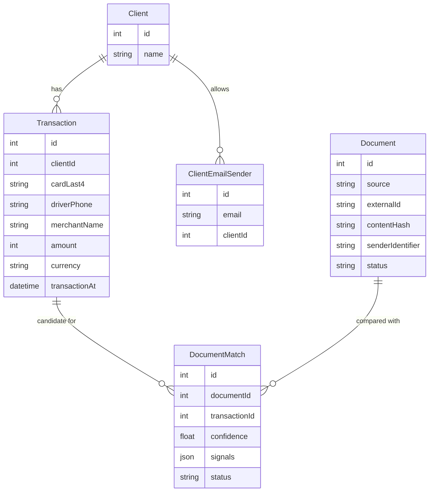
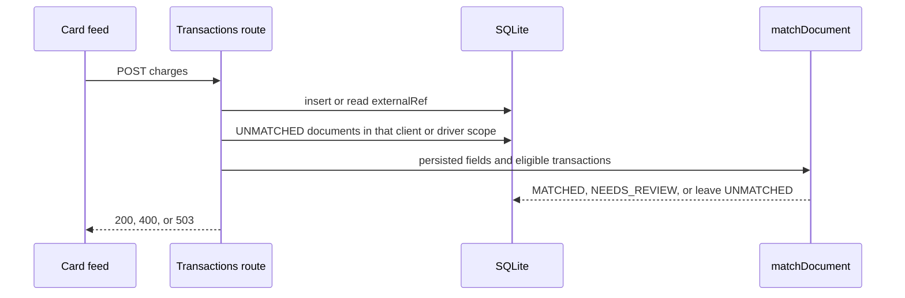
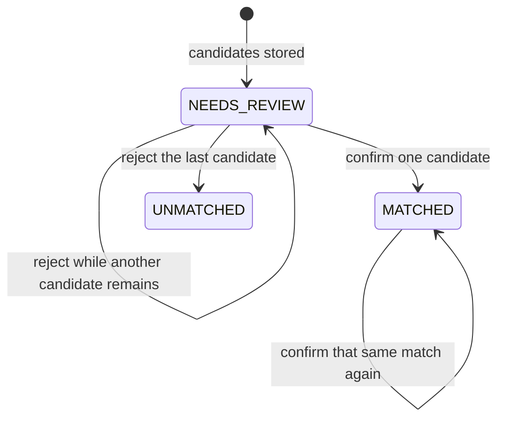

# Technical design

Phase 8 has both webhooks, confirm and reject, rematch when a charge arrives, and `/review`. Items marked **Proposed** are not settled. **Accepted** items were confirmed on 15 Oct 2026. The assignment's own shapes are **Required**.

## Directory structure

Tree after phase 8. `/review` is implemented.

```
brijesh/
├── app/
│   ├── api/
│   │   ├── webhooks/email/route.ts       Required
│   │   ├── webhooks/whatsapp/route.ts    Required
│   │   └── transactions/route.ts         Implemented, BON-002
│   ├── review/                           Implemented, BON-001
│   │   ├── page.tsx                      Loads the queue
│   │   ├── review-board.tsx              Confirm and reject
│   │   ├── document-card.tsx
│   │   ├── loading.tsx
│   │   └── error.tsx
│   ├── layout.tsx
│   └── page.tsx
├── lib/
│   ├── prisma.ts                         Required boilerplate
│   ├── utils.ts                          Required boilerplate
│   ├── logger.ts                         Required boilerplate
│   ├── extraction/
│   │   ├── types.ts                      Required interface
│   │   ├── schema.ts                     Zod boundary
│   │   ├── mock-extractor.ts             Required
│   │   ├── fixtures.ts
│   │   ├── hash.ts
│   │   └── to-fields.ts                  ExtractedDocument to matcher input
│   ├── media/
│   │   ├── types.ts
│   │   └── fixture-media-store.ts        Required
│   ├── matching/
│   │   ├── config.ts                     Accepted numbers, ADR 0004
│   │   ├── signals.ts
│   │   ├── normalize.ts
│   │   └── similarity.ts
│   ├── services/
│   │   ├── transaction-matcher.ts        Required pure function
│   │   ├── sender-scope.ts
│   │   ├── document-ingestion.ts         Required
│   │   ├── document-processing.ts
│   │   ├── match-persistence.ts
│   │   ├── review-decisions.ts
│   │   └── rematch.ts                    Implemented, BON-002
│   ├── review/
│   │   ├── queue.ts                      NEEDS_REVIEW and UNMATCHED query and view model
│   │   └── format.ts                     Halalas, Riyadh dates, action text
│   └── actions/
│       ├── safe-action-client.ts         Required boilerplate
│       └── review.ts                     Required
├── prisma/schema.prisma
├── prisma/seed.ts
├── fixtures/documents/                   Synthetic bytes, not scanned images
├── fixtures/extractions/                 ExtractedDocument JSON
├── fixtures/media-map.json
├── __tests__/matching/
├── __tests__/ingestion/
├── IMPLEMENTATION.md                     Required at submission, written in phase 2
└── docs/                                 This documentation
```

`lib/services/transaction-matcher.ts` is the file the brief names. Helpers stay under `lib/matching/` so that file stays the decision procedure.

## Module responsibilities

| File | Responsibility |
| --- | --- |
| `app/api/webhooks/*/route.ts` | Parse JSON, validate, call ingestion, set status codes, schedule processing. No scoring. |
| `lib/services/document-ingestion.ts` | Sender normalization, hashing, duplicate detection, insert. |
| `lib/services/document-processing.ts` | Claim, extract, scope, match, persist. Catches extractor and matcher failures. |
| `lib/services/sender-scope.ts` | Phone to E.164. Email to client. Query candidate transactions. |
| `lib/services/transaction-matcher.ts` | `matchDocument`. Outcome and ranked candidates. |
| `lib/matching/*` | One signal each, plus normalization. All tunable numbers live in `config.ts`. |
| `lib/services/match-persistence.ts` | Transactional write of document status and match rows. |
| `lib/services/review-decisions.ts` | Confirm and reject. The action file only wraps this. |
| `lib/extraction/types.ts` | The assignment `ExtractedDocument` and `DocumentExtractor` interfaces. |
| `lib/extraction/schema.ts` | Zod check before a result is trusted. |
| `lib/extraction/mock-extractor.ts` | SHA-256 of the bytes to a fixture result. Unknown hash returns `UNKNOWN` and nulls, confidence 0. |
| `lib/extraction/to-fields.ts` | Drops VAT, invoice number, and raw text before `matchDocument`. |
| `lib/media/fixture-media-store.ts` | Media id to a file under `fixtures/`. The id is not a path. |
| `prisma/seed.ts` | Two clients, 15 transactions, phones and mailboxes. Does not delete documents (REC-006). |

## Matching contract

**Accepted.** [ADR 0004](decisions/0004-scoring-and-auto-match-gates.md). The assignment leaves the similarity measure and the numeric thresholds open. The thresholds are the accepted ADR. The similarity measure below is the choice locked by the phase 2 tests. Pre-VAT is not a separate rule.

### Input and output

`matchDocument(doc, transactions, scope, config?)` in `lib/services/transaction-matcher.ts`.

| Input | Fields that affect the result |
| --- | --- |
| `doc` | `documentType`, `merchantName`, `totalAmount` (integer halalas), `currency`, `documentDate`, `cardLast4`, `extractionConfidence` |
| `transactions` | `id`, `clientId`, `driverPhone`, `merchantName`, `amount`, `currency`, `transactionAt`, `cardLast4`, `hasConfirmedDocument` |
| `scope` | `{ kind: 'EMAIL', clientId }` or `{ kind: 'WHATSAPP', driverPhone }` |
| `config` | Optional. Production numbers live in `lib/matching/config.ts` |

```typescript
type MatchResult = {
  outcome: 'AUTO_MATCHED' | 'NEEDS_REVIEW' | 'UNMATCHED';
  reason: string;
  candidates: Array<{
    transactionId: number;
    confidence: number;
    signals: Partial<Record<'amount' | 'merchant' | 'date' | 'cardLast4', number>>;
    flags: Array<'TIP' | 'CARD_MISMATCH' | 'ALREADY_CONFIRMED'>;
  }>;
};
```

Sender scope is a hard filter, not a weighted signal (FR-016). An email candidate must have the same `clientId`. A WhatsApp candidate must have the same `driverPhone` string. The caller normalizes the phone to E.164 before the call. Out-of-scope rows are dropped even if they were included in the array.

`hasConfirmedDocument` is how a pure function learns that the transaction already has a `CONFIRMED` or `AUTO_CONFIRMED` document (FR-021). The matcher does not query the database.

### Precedence

1. `documentType === 'UNKNOWN'`, or an amount that is missing, non-finite, non-integer, or not positive: `UNMATCHED`. No throw (FR-027, CON-006).
2. Drop a transaction that is out of scope, duplicated by an earlier `id`, or unusable (non-integer or non-positive amount, currency differs, `transactionAt` is not a real timestamp). A missing document currency does not drop the row. A missing or unreadable document date does not drop the row (ADR 0004).
3. Score amount, then merchant, then card, then date. Drop the candidate when the amount is outside the bands below, or the merchant score is below 0.25. A card hit does not keep that merchant.
4. Combine the available signals and round to 4 decimal places before any comparison (REC-001).
5. Keep scores at or above 0.50, best first, at most 5. Equal scores break toward the smaller transaction id.
6. Decide from the shortlist:

| Outcome | When | IDs |
| --- | --- | --- |
| `UNMATCHED` | Nothing left at or above 0.50 | FR-020, FR-026 |
| `NEEDS_REVIEW` | Two or more shortlisted scores are within 0.10 | FR-019, FR-023 |
| `NEEDS_REVIEW` | The top transaction is already confirmed | FR-021 |
| `AUTO_MATCHED` | Top score is at least 0.85, the lead over the next is greater than 0.10, extraction confidence is at least 0.60, the top row is not flagged `TIP` or `CARD_MISMATCH`, it is not already confirmed, and a present date score is greater than 0 | FR-018, FR-022 |
| `NEEDS_REVIEW` | Any other shortlist, including the 57.50 versus 63.25 tip | FR-019, FR-024 |

A missing date does not block auto-match. Amount plus merchant, with no card and a same-day date, can clear 0.85. Amount alone cannot.

### Signal rules

| Signal | Weight | Score |
| --- | --- | --- |
| Amount | 0.40 | Exact = 1. Absolute difference within the rounding band = 0.9. Charge above the receipt by at most 20% = 0.5 and flag `TIP`. Otherwise the candidate is out. A charge below the receipt, outside the band, is out (ASM-002). |
| Merchant | 0.25 | Normalize, then similarity in `[0, 1]`. Below 0.25 the candidate is out. A missing name omits the signal. |
| Card last 4 | 0.20 | Equal digits = 1. Different = 0 and flag `CARD_MISMATCH`, which blocks auto-match. Missing on either side = unavailable, not a penalty. |
| Date | 0.15 | Riyadh calendar day, UTC+3, no daylight saving (ASM-001). Same day = 1. Gap of 1 through 7 days = `1 - dayGap / 8`. Gap of 8 or more = 0, and that 0 blocks auto-match. Missing or unreadable = unavailable, not 0. |

Rounding band (ASM-003): the larger of 5 halalas and 1% of the document amount. It is checked before the tip band, so a difference of a few halalas is rounding, not a tip.

```
mean       = sum(weight * score) / sum(weights of available signals)
coverage   = min(1, availableWeight / 0.75)
confidence = round4(mean * coverage)
```

A missing signal is omitted. It is not a zero.

| Case | Expected |
| --- | --- |
| Exact amount, merchant, date, and card | `AUTO_MATCHED` |
| Two branches, same amount and day | `NEEDS_REVIEW` |
| 57.50 versus 63.25, same merchant and day | `NEEDS_REVIEW`, tip flag |
| Second photo after a confirm | `NEEDS_REVIEW` |
| No in-scope transaction | `UNMATCHED` |
| `UNKNOWN`, null amount | `UNMATCHED` |
| Exact amount and merchant, no card, same day | `AUTO_MATCHED` |
| Exact amount, merchant, and card, date missing | `AUTO_MATCHED` |
| Exact amount, merchant, and card, date 8 or more days away | `NEEDS_REVIEW` |

A 15% gap is not labeled pre-VAT (ASM-005). It sits inside the 20% band, so it is flagged `TIP` and cannot auto-match.

### Merchant normalization

Lowercase, remove apostrophes, strip other punctuation and diacritics, drop legal suffixes (`llc`, `co`, `est`), drop all-digit tokens and the city tokens `ruh`, `jed`, `dmm`, `riyadh`. Expand a whole token `st` to `station`. Do not expand those letters inside a word.

Similarity is the greater of token Jaccard and character Dice. A name that is only a generic token (`station`, `retail`, `store`, `shop`, `market`) must not score 1.0 against a longer different name. `ALFANAR FUEL ST 04 RUH` and `Alfanar Fuel Station` normalize to the same tokens (FR-032).

Arabic folding is not required by the assignment. It is out of this matcher.

## Extraction contract

**Accepted.** The assignment's `DocumentExtractor` interface. FR-010, FR-011, FR-012. The mock does not read Prisma, the network, the clock, or `Math.random`.

### Input and output

```typescript
extract(file: Buffer, mimeType: string): Promise<ExtractedDocument>
```

`ExtractedDocument` is the assignment shape: `documentType` of `RECEIPT`, `TAX_INVOICE`, or `UNKNOWN`; nullable merchant, VAT number, total in halalas, ISO currency, ISO 8601 date, card last 4, and invoice number; `rawText`; `extractionConfidence` from 0 to 1.

`toExtractedFields` copies the seven fields `matchDocument` already accepts. VAT, the invoice number, and raw text stay on the extraction result for a later save. They are not a second matcher representation.

The MIME argument is required by the interface. The mock does not use it as a lookup key, and it does not trust a file extension. A real extractor can branch on the MIME type behind the same method. Allowing or rejecting a MIME type on a webhook is phase 4 and phase 5.

### Rules

| Input | Result |
| --- | --- |
| SHA-256 matches a result fixture | A copy of that `ExtractedDocument` |
| SHA-256 matches the unreadable-scan fixture | Throws `ExtractionError` with code `UNREADABLE` |
| Any other bytes, including an empty buffer | `documentType: UNKNOWN`, null fields, `rawText: ''`, confidence 0. No throw |
| `file` is not a `Buffer`, or `mimeType` is not a string | Throws `ExtractionError` with code `INVALID_INPUT` |
| A fixture result fails the Zod schema | Throws `ExtractionError` with code `INVALID_OUTPUT` |

Missing merchant, date, card, currency, or amount is `null`. It is not an empty string and not zero. A non-ISO date, a lowercase currency, a fractional amount, or a card that is not four digits fails the schema. The matcher still treats a garbage date string as "unreadable" if a caller skips the schema. The pipeline must not skip it.

A VAT number that is not 15 digits still parses. `isFifteenDigitVatNumber` reports that. Matching ignores VAT (CON-008).

Two files may extract to the same fields. That does not make them one document. Deduplication uses the hash of the bytes later (FR-005), not the extraction JSON.

### Fixtures

The files under `fixtures/documents/` are short synthetic text. They are not photographs. `fixtures/media-map.json` declares the MIME type a webhook would have sent. `media_4471` is the sample WhatsApp id and points at the exact Alfanar invoice, declared as `image/jpeg` even though the file ends in `.txt`.

| Fixture | Extraction | Matcher outcome against the seed, client 1 |
| --- | --- | --- |
| `exact-alfanar` | Tax invoice, 125.00 SAR, card 4242, 14 Jun 2025, confidence 0.96 | `AUTO_MATCHED` transaction 1 |
| `alfanar-second-photo` | Same fields, different bytes | Same decision. Not the same file |
| `albaik-ambiguous` | 48.00 SAR, 12 Jun 2025 | `NEEDS_REVIEW`, transactions 2 and 3 |
| `chefs-table-tip` | 57.50 SAR against the 63.25 SAR charge | `NEEDS_REVIEW`, tip |
| `low-confidence` | Same as the exact invoice, confidence 0.59 | `NEEDS_REVIEW` |
| `missing-date`, `missing-card` | That field is null | `AUTO_MATCHED`. The signal is omitted |
| `missing-merchant` | Merchant null, amount, card, and day exact | `AUTO_MATCHED`. Merchant weight is omitted and the other three scores are 1, so coverage stays at the 0.75 floor |
| `unreadable-amount` | Amount and currency null | `UNMATCHED`, `AMOUNT_UNUSABLE` |
| `missing-charge` | 333.00 SAR, no seeded charge | `UNMATCHED`, `NO_CANDIDATE` |
| `unreadable` | `UNKNOWN`, null amount | `UNMATCHED`, `UNKNOWN_DOCUMENT` |
| `unreadable-scan` | Throws | No matcher call. Storing `FAILED` is phase 4 |

Replacing the mock means a new class with `extract(file, mimeType)`. Callers keep the `DocumentExtractor` type. `MockExtractor` stays the default (ADR 0002).

## Data model

**Required** enums and the three models come from the assignment. **Proposed** columns are marked. Integer ids are **accepted** ([ADR 0001](decisions/0001-integer-primary-keys.md)).



`Client` and `ClientEmailSender` are accepted in [ADR 0007](decisions/0007-email-sender-scope.md). They are how an email address becomes a `clientId`. The diagram omits columns that are not needed to see the relationships.

`Document` columns beyond the brief, present in the phase 1 schema: `scope`, `statusReason`, `mimeType`, `content` (bytes), `processingStartedAt`, `invoiceNumber`, `extractionConfidence`, `filename`. `scope` is ADR 0003. `content`, `mimeType`, and `processingStartedAt` are ADR 0006. `statusReason` holds values such as `UNKNOWN_SENDER` (ADR 0007). `invoiceNumber` and `extractionConfidence` are fields the extractor returns that the sample model omitted. The brief's extraction columns stay, so a reader can see the fields without parsing JSON.

Uniqueness:

| Key | Status | Record |
| --- | --- | --- |
| `externalId` unique, email value `messageId#attachmentIndex` | Accepted | DEV-002, ADR 0003 |
| `(scope, contentHash)` unique | Accepted | DEV-001, ADR 0003 |
| `(documentId, transactionId)` unique | Required by the sample schema | — |
| One `CONFIRMED` or `AUTO_CONFIRMED` row per `transactionId` | Accepted. Hand-written partial index | ADR 0005, FR-031 |
| One confirmed row per `documentId` | Accepted. Hand-written partial index | ADR 0005 |

Money is `Int` halalas (CON-006). `Transaction.currency` defaults to `SAR`.

`DocumentMatch.signals` stores the numbers that were available plus flags such as `TIP`. Shape **proposed**:

```json
{ "signals": { "amount": 0.5, "merchant": 1, "date": 1, "cardLast4": 1 }, "flags": ["TIP"] }
```

The brief asks for a per-signal map. Flags are an addition so a tip is visible. NFR-004 is met by the `signals` object either way.

## API contracts

### Email

**Implemented.** `POST /api/webhooks/email`. No signature. HMAC stays deferred (ADR 0002).

The body is the assignment sample: `messageId`, `from`, `to`, `subject`, `receivedAt`, and `attachments[]` of `{ filename, contentType, contentBase64 }`. `from` and `to` are lower-cased. `messageId` must not contain `#`, because the stored id is `messageId#attachmentIndex`.

`contentType` must be `application/pdf`, `image/jpeg`, `image/png`, or `image/webp`, ignoring any `;` parameters. The filename is stored and is not used to decide the type. Decoded bytes must be non-empty and at most 10 MiB. An empty attachment list, bad base64, or an unsupported type is 400 and stores nothing.

| Status | When | Body |
| --- | --- | --- |
| 400 | JSON failed | `{ "error": "INVALID_JSON", "issues": [{ "path", "message" }] }` |
| 400 | Zod, media type, or size failed | `{ "error": "INVALID_PAYLOAD", "issues": [{ "path", "message" }] }` |
| 200 | Accepted or duplicate | `{ "documents": [{ "documentId", "result": "created" or "duplicate" }] }` |
| 503 | The insert failed for a reason other than a unique conflict | `{ "error": "STORE_FAILED" }` |

The 200 body does not include the match outcome. Matching runs in `after()`. A duplicate `externalId`, or the same SHA-256 in the same `EMAIL:<address>` scope, returns the existing id and does not insert. The same bytes from another sender are a different scope and a new document (ADR 0003). A second file with the same extracted fields and different bytes is a new document.

An unknown sender is stored and becomes `UNMATCHED` / `UNKNOWN_SENDER`. The matcher is not called (ADR 0007). Extractor throws and invalid extraction become `FAILED`. `AUTO_MATCHED` becomes `MATCHED` plus one `AUTO_CONFIRMED` row (`decidedBy: "system"`). `NEEDS_REVIEW` stores each shortlisted row as `CANDIDATE`. `UNMATCHED` stores no match rows. If the auto-confirm hits the partial unique index, the write rolls back and the document is saved as `NEEDS_REVIEW`.

### WhatsApp

**Implemented.** `POST /api/webhooks/whatsapp`. No signature. HMAC stays deferred (ADR 0002).

The body is the assignment envelope: `entry[].changes[].value.messages[]`. An image message has `id`, `from`, `timestamp`, `type: "image"`, and `image.id`, `image.mime_type`, `image.sha256`. Extra keys such as `object` are ignored. `sha256` must be present and is not the stored hash. The sample value `a3f1c9...` does not match the fixture bytes and is still accepted.

`from` is normalized to E.164 before it is stored (ASM-007, ADR 0007). Separators are removed. A leading `+` or `00` is a country code. A Saudi mobile `05XXXXXXXX` becomes `+9665XXXXXXXX`. Anything else is treated as a country code without a plus, and is rejected when it is not 8 to 15 digits starting at 1–9. No other country code is assumed. The stored scope is `WHATSAPP:+966551234567`. Candidates are transactions with that exact `driverPhone`.

`image.id` is a key in `FixtureMediaStore`, never a filesystem path. The stored MIME type is the type on the map entry, not the filename. Allowed resolved types are `image/jpeg`, `image/png`, and `image/webp`. `media_4471` is declared `image/jpeg` and its bytes are synthetic text.

| Status | When | Body |
| --- | --- | --- |
| 400 | JSON failed | `{ "error": "INVALID_JSON", "issues": [{ "path", "message" }] }` |
| 400 | Envelope failed, including an image message with no `image` | `{ "error": "INVALID_PAYLOAD", "issues": [{ "path", "message" }] }` |
| 200 | Accepted, duplicate, or nothing to store | `{ "documents": [{ "documentId", "result": "created" or "duplicate" }] }` |
| 503 | Insert failed, or the media store failed for a reason other than an unknown id | `{ "error": "STORE_FAILED" }` |

A non-image message, an invalid phone, an unknown media id, a resolved type that is not an image, or a file over 10 MiB is omitted from `documents`. Nothing is stored. A missing file is not saved as `FAILED`: `Document.content` is required, and the content hash must be the SHA-256 of those bytes. A valid phone that matches no driver is stored and becomes `UNMATCHED` / `UNKNOWN_SENDER`. The matcher is not called.

The same message id, or the same bytes from the same normalized phone, returns the existing id. The same bytes from another phone are a new document (ADR 0003). Matching uses the same `after()` path as email.

### Transactions

**Implemented.** `POST /api/transactions`. No signature. The body is `{ transactions: [...] }`. Each charge has `externalRef`, `clientId`, `cardLast4`, `merchantName`, `amount` in halalas, and `transactionAt`. `driverPhone` is optional and is normalized the same way as a WhatsApp sender. `currency` defaults to `SAR`. At most 20 charges. An unknown `clientId` is 400 and stores nothing.

`externalRef` is unique. The column was added in `20261015143000_transaction_external_ref` because the sample `Transaction` model had no redelivery key. Seeded rows leave it null. A repeated ref returns the existing id and does not change the stored charge.



Only `UNMATCHED` documents are reconsidered. `UNKNOWN`, a null amount, `MATCHED`, `NEEDS_REVIEW`, `FAILED`, and `RECEIVED` stay as they are. A `REJECTED` pair is not offered again. Extraction is read from the document row. The matcher is not given other clients or other drivers. If the auto-confirm loses the partial unique index, the document is saved as `NEEDS_REVIEW`. A document that leaves `UNMATCHED` during the write is left alone.

| Status | When | Body |
| --- | --- | --- |
| 400 | JSON or Zod failed, or the client is unknown | `{ "error": "INVALID_JSON" or "INVALID_PAYLOAD", "issues": [...] }` |
| 200 | Stored or replayed | `{ "transactions": [{ "transactionId", "result": "created" or "duplicate" }] }` |
| 503 | Insert or rematch failed for a reason other than a duplicate ref | `{ "error": "STORE_FAILED" }` |

Competing candidates on other documents are not withdrawn (REC-003). The second document goes to review when the charge is already confirmed.

### Server actions

**Implemented.** `confirmMatch` and `rejectMatch` in `lib/actions/review.ts`. `/review` is the only caller. next-safe-action 8.7.3 is called with `.inputSchema()` (DEV-005). The input is `{ matchId: number }`, a positive integer, and no other fields. `decidedBy` is not an input. There is no signed-in user (ASM-006), so a successful human decision is stored as `reviewer`. After the decision function returns, the action calls `revalidatePath('/review')`. That does not change the decision.

| Result | When |
| --- | --- |
| `CONFIRMED` | A `CANDIDATE` on a `NEEDS_REVIEW` document, in that sender's scope, became `CONFIRMED`. Siblings became `REJECTED`. The document is `MATCHED` / `REVIEWER_CONFIRMED`. |
| `REJECTED` | A `CANDIDATE` became `REJECTED`. The document stays `NEEDS_REVIEW` while another candidate remains, and becomes `UNMATCHED` / `ALL_CANDIDATES_REJECTED` when none remain. |
| `ALREADY_CONFIRMED` | The same match is already `CONFIRMED` or `AUTO_CONFIRMED`. No second row is written. |
| `ALREADY_REJECTED` | The match is already `REJECTED`, including a confirm that would revive it. |
| `CONFLICT` | The transaction or the document already has a confirmation, the document is not `NEEDS_REVIEW`, the match is outside the sender's client or driver, or a reject targets a confirmation. The transaction rolls back. |
| `NOT_FOUND` | No match has that id. |

The guarded write is `updateMany` from `CANDIDATE` to `CONFIRMED` inside one database transaction. A `P2002` from either partial unique index rolls that transaction back and returns `CONFLICT`. Any other database error is left as an error. The action wrapper returns `REVIEW_FAILED` and does not describe the row.



A later `persistOutcome` does not rewrite a document that is already `MATCHED`, `NEEDS_REVIEW`, `UNMATCHED`, or `FAILED`. REC-003, withdrawing the same charge on other documents, is not implemented.

## Validation rules

| Input | Rule | ID |
| --- | --- | --- |
| Email `from` | Email address | FR-003 |
| Email attachment | Base64 that decodes, size cap proposed at 10 MiB | FR-003 |
| WhatsApp image | `id`, `mime_type` present when `type` is `image` | FR-002 |
| Amounts written to `Int` columns | Integers. Reject fractional JSON numbers at the boundary | CON-006 |
| `matchId` | Positive integer | CON-012 |
| Extractor output | Checked against a Zod object that mirrors `ExtractedDocument` before it is stored | FR-010 |
| VAT number | 15 digits when present. A wrong length does not crash matching. It is ignored as a signal. The assignment does not make VAT a matching signal | CON-008 |

Sender scope is not a Zod rule. It is a query filter (FR-009).

## Error cases

| Case | Planned result |
| --- | --- |
| Extractor throws | `FAILED`, reason recorded, webhook already 2xx |
| Extractor returns `UNKNOWN` or a null amount | `UNMATCHED`, not retried by rematch |
| Extractor returns a value that fails the Zod contract | `FAILED` |
| Media id missing from the map | `FAILED` or skipped, 2xx |
| Sender unknown | Document stored, status `UNMATCHED`, reason `UNKNOWN_SENDER`. Matcher not called. [ADR 0007](decisions/0007-email-sender-scope.md) |
| Currency differs | Candidate excluded |
| Two workers process one `RECEIVED` row | Compare-and-set. One continues. [ADR 0006](decisions/0006-processing-model.md) |
| Auto-confirm loses a race | Roll back, reload, save as `NEEDS_REVIEW` |
| Confirm when the transaction is already confirmed | `CONFLICT`, no partial writes |
| Reject the last candidate | Document `UNMATCHED` |

## Decisions that are not settled

Still open, and not part of the accepted proposal:

- REC-003, withdrawing competing offers on other documents. FR-031 does not depend on it.

Accepted and safe to follow: project root, integer ids, ADR 0002 through ADR 0007, the scoring numbers in ADR 0004, and the Must requirements. BON-001 and BON-002 are built. HMAC and a live extractor stay after this page.
