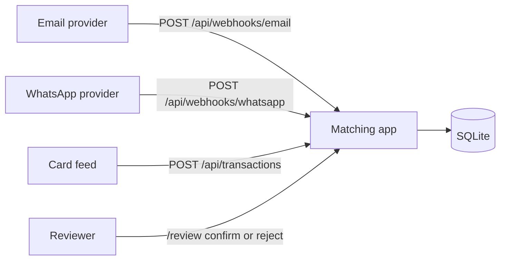
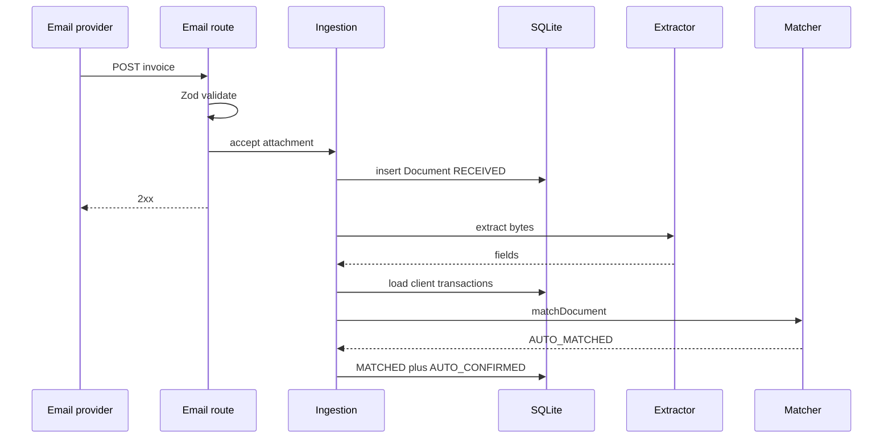
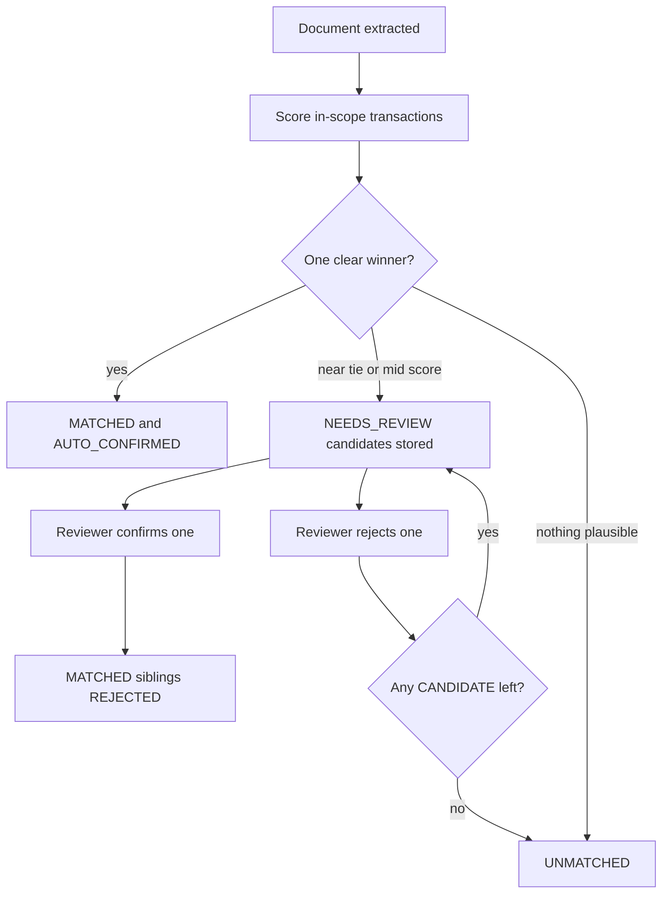

# User flows

Actors and the planned paths through the system. None of these run today. Contracts that are still proposals are marked. Requirement IDs point at [REQUIREMENTS.md](REQUIREMENTS.md).

## Actors

| Actor | Role |
| --- | --- |
| Email provider | Posts the inbound-parse JSON. Redelivers on failure. |
| WhatsApp provider | Posts the simplified Cloud API JSON. Redelivers on failure. |
| Media store | Resolves a WhatsApp media id to bytes. In this exercise it is a fixture map (FR-008). |
| Card feed | Posts new transactions. Planned bonus (BON-002). |
| Reviewer | Confirms or rejects a candidate. The page is BON-001. The actions are FR-028 and FR-029. |
| Matcher | Pure function. No actor calls it over HTTP. |

## System context

The card feed and the reviewer are bonus paths. The two webhooks are required.

## Flow A: email invoice, clear match

Preconditions: the database is seeded (FR-014). The sender address is mapped to a client (ASM-004). The attachment bytes are a known fixture (FR-011). One in-scope transaction agrees on amount, merchant, and date.

Main path:

1. The provider posts a valid body (FR-001).
2. The route validates it (FR-003). A bad body returns 400 and stores nothing.
3. The app hashes the bytes, inserts one `Document` in `RECEIVED`, and responds 2xx (FR-006).
4. After the response, extraction runs (FR-010).
5. Candidates are loaded for that client only (FR-009).
6. The matcher returns `AUTO_MATCHED` (FR-018, FR-022).
7. The document becomes `MATCHED` with one `AUTO_CONFIRMED` row (FR-031).

Outcome: one document, one confirmed match, no second document if the provider posts the same body again (FR-004, FR-005).

Alternative: the invoice matches nothing plausible (FR-026). The document becomes `UNMATCHED`. The provider still got 2xx.

Failure: the extractor throws (FR-007, FR-027). The document becomes `FAILED` or `UNMATCHED`. The HTTP status is still 2xx.

## Flow B: WhatsApp receipt

Preconditions: `from` normalizes to a seeded driver phone (ASM-007). `image.id` is in the fixture map.

Main path: same as Flow A, except the route asks the media store for bytes before it can hash them (FR-008), and candidates are that driver's transactions only (FR-009).

Alternative paths:

| Condition | Result |
| --- | --- |
| Message is not an image | Acknowledged, not stored. Proposed behavior, copied from both references. Not an assignment sentence. |
| Media id is unknown | Document stored as `FAILED`, or the message is skipped with 2xx. Must not 500 (FR-006, FR-008). The exact body is proposed in [TECHNICAL_DESIGN.md](../TECHNICAL_DESIGN.md). |
| Same photo, new message id | Duplicate via content hash (FR-005, FR-025). |
| Sender phone matches no driver | `UNMATCHED`. The matcher is not given another client's rows. |

## Flow C: ambiguous pair, then a person decides

Preconditions: two transactions share amount, day, and merchant chain, and both are in scope (FR-023).

Main path:

1. Ingestion runs as in Flow A.
2. The matcher returns `NEEDS_REVIEW` with both candidates ranked (FR-019).
3. Both rows are stored as `CANDIDATE`. The document is `NEEDS_REVIEW`.
4. The reviewer confirms one (FR-028). That row becomes `CONFIRMED`. The sibling becomes `REJECTED`. The document becomes `MATCHED`.
5. A second click does nothing harmful (FR-030).

Alternative: the reviewer rejects one, then the other (FR-029). After the last rejection the document is `UNMATCHED`.

Failure: two documents try to confirm the same transaction. The database allows one winner (FR-031). The loser rolls back.

## Flow D: tip or rounding

Preconditions: the receipt total is 57.50 SAR and the charge is 63.25 SAR, same merchant and day (FR-024).

Main path: the amount signal records the gap. The outcome is `NEEDS_REVIEW`, not `AUTO_MATCHED`. A few halalas of rounding may score higher than a tip. The numeric bands are proposed in [ADR 0004](../decisions/0004-scoring-and-auto-match-gates.md) and are not accepted yet.

Outcome: a person sees the amount gap in the stored signals (NFR-004).

## Flow E: duplicate of an already attached receipt

Preconditions: transaction T already has an `AUTO_CONFIRMED` or `CONFIRMED` document. A new photo of that receipt arrives with different bytes, so FR-005 does not treat it as the same file (FR-021).

Main path: the matcher may rank T first and must not auto-confirm. The document goes to `NEEDS_REVIEW`.

Outcome: T still has one confirmed document (FR-031).

## Flow F: document arrives before the charge

Preconditions: the extraction is usable, and no in-scope transaction fits (FR-026).

Main path: the document is `UNMATCHED`.

Later, if BON-002 is built: the card feed stores the charge and matching runs again. A clear winner becomes `MATCHED`. A tie becomes `NEEDS_REVIEW`. Garbage extractions are not retried, because a new charge cannot repair a null amount (FR-027).

This later path is `proposed`.

## Flow G: malformed webhook

Preconditions: none.

| Input | Outcome |
| --- | --- |
| Body is not JSON | 400, nothing stored (FR-003) |
| JSON fails the schema, including a `from` that is not an email on the email route | 400, nothing stored |
| Valid shape, then extraction fails | 2xx, document in a terminal state (FR-006, FR-007) |
| The insert itself fails | Proposed: 503 so the provider retries. Idempotency makes the retry safe (FR-004). Not an assignment sentence. |

## What is intentionally absent

- No login flow (ASM-006).
- No HMAC check until BON-005, which waits until after the review page.
- No path where one invoice confirms several transactions. BON-003 is a written sketch only.
